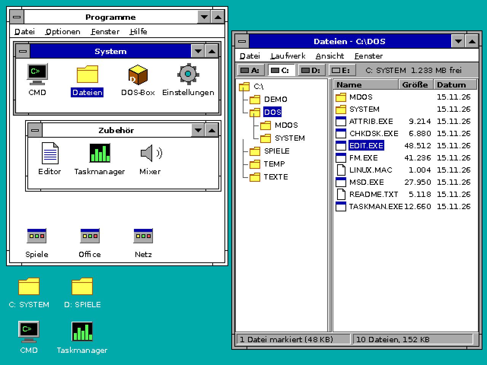
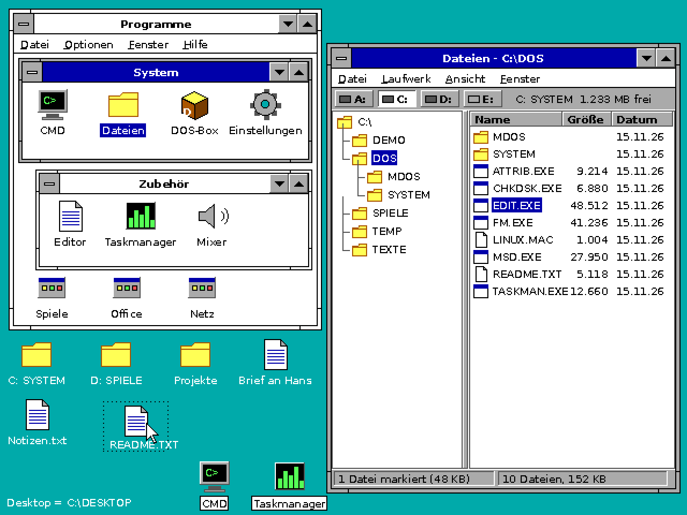

<!-- SPDX-License-Identifier: GPL-2.0-or-later -->
# Plan: Grafische Oberfläche und Win16 für AT-DOS

Stand: 15.11.2026, abgestimmt mit dem Nutzer; Stil/Shell austauschbar
nachgetragen 25.11.2026. Erster Code (GUI-Prozess, KERNEL/USER/GDI für
Win16) seit 25.11.2026, siehe „Stand: GUI-Prozess“.

## Entscheidungen

- **Win16 nativ** ist die Schnittstelle der GUI. Alte Windows-3.x-Programme
  laufen direkt auf AT-DOS, ohne echtes Windows 3.1 (auch nicht in einer
  DOS-Box). Win16-Programme sind 16-Bit-Protected-Mode-Programme im
  NE-Format und passen zum Kernel (LDT je Task, Selektoren, 286-Code).
- **Die ganze Win16-Schicht läuft auch unter AT-DOS 5.x**: 286-Code,
  kooperativ, ohne Paging/V86. Auf 5.x bleibt „Programme bleiben 286“.
- **Eigener Prozess**: Die GUI wird bei Bedarf gestartet (`GUI` aus CMD,
  wie `startx`), läuft in einer eigenen Grafiksitzung, Alt+Esc führt zu
  CMD und den Boxen. Beendet sich die GUI, beendet sie ihre Programme.
  Startet man ein Win16-Programm aus CMD, startet die GUI mit.
- **Kein GUI-Code im Kernel** (DGROUP ist voll). Der Kernel liefert nur
  die Grundlagen (NE-Lader, DLLs, IPC).

## Aufbau

- Wie PM 1.x und Windows 3.x, nicht wie X: kein Protokoll je Zeichen-
  aufruf (auf dem 386 zu teuer). Der GUI-Prozess besitzt Bildschirm,
  Fensterliste und Eingabe; USER und GDI sind DLLs mit gemeinsamen Daten,
  jedes Programm zeichnet unter einer Sperre selbst in den Bildspeicher.
- Grafiktreiber als DLL mit IOPL-Segment im Ring 2 (wie OS/2 1.x) – geht
  auf 286 und 386 gleich, Programme bleiben im Ring 3.
- Beim Sitzungswechsel wird das Bild nicht gesichert, die GUI zeichnet
  alle Fenster neu (480 KB bei 800×600×256 wären auf 2 MB zu viel).

### Verzeichnisse im Repository (abgestimmt 25.11.2026)

Eigenes Verzeichnis `gui/` auf oberster Ebene (neben `apps/`, `drivers/`,
`atdoscm/`):

```
gui/
  kernel/   KERNEL.EXE-Ersatz für Win16 (Exporte, Speicher, Module)
  user/     USER: Fenster, Nachrichten, Steuerelemente, Dialoge
  gdi/      GDI-Kern: Zeichnen, Clipping, Schriften
  style/    cua/, mini/ (fvwm2), w95/ – austauschbare Stile
  shell/    Programm-Manager-Art, Taskleiste, Dateimanager, Pager
  drv/      Grafiktreiber: vga/, et4000/, gd5434/, trio3d/
  res/      eigene Symbole, Bitmaps, Systemschrift
  include/  gemeinsame Header (Win16-Typen, Treiberschnittstelle DDI)
```

Der NE-Lader mit DLLs ist eine Grundlage des Kernels und kommt nach
`kernel/`, nicht nach `gui/`. build.sh bekommt einen eigenen Abschnitt
für die GUI (wie beim Netzwerk). Entwürfe und Bilder bleiben unter
`docs/gui/`.

### Kernel-Grundlagen (Stufe 0, für 5.x und 6.0)

1. NE-Lader mit DLLs: gemeinsamer Code, gemeinsame Datensegmente,
   Importe über Ordinalzahl/Namen. Open Watcom linkt NE direkt
   (`format windows`, `format os2`) – auch für die eigenen GUI-Programme.
2. IPC: Semaphoren, gemeinsamer Speicher; Threads später.

### Stand: NE-Lader Stufe 1 (25.11.2026, nur `main`)

Variante A (Entscheidung des Nutzers): DLL-Selektoren wie OS/2 1.x –
von oben in der LDT, in allen Tasks gleich; die gemeinsame LDT für
Win16 (Frage 1 unten) kommt später darauf.

- `kernel/neload.c` (KTEXT4, ~6 KB Code): `load_program` nimmt NE, wenn
  `load_image` „kein FX“ meldet; `dos_kind` hält NE nicht mehr für ein
  DOS-Programm (vorher lief der MZ-Stub „This is an OS/2 executable“ in
  der Box).
- EXE: Segment k -> LDT-Eintrag k + 1 (ab 2), Autodata mit Heap und
  Stapel (SS:SP 0 -> Stapel am Ende des Autodata wie OS/2), Start
  CS:IP/SS:SP/DS aus dem Kopf, Merker „lange Namen“ aus Byte 37h.
- DLL: einmal geladen in einer Modultabelle (Kernelsegment `ne_sel`, bis
  15 Module zu je 32 Segmenten, 8 Abhängigkeiten, Einsprung- und
  Namenstabelle). Selektoren aus `ne_sh` (Bitmap) von oben, frei in allen
  laufenden Tasks; jeder Task bekommt Alias-Einträge (`D_ALIAS`, gibt
  seg_free nicht frei), `ldt_free` in DosAllocSeg/VioGetBuf überspringt
  sie. Gesucht wird im Verzeichnis des Programms, dann `\DOS\SYSTEM`
  und `\DOS` des Startlaufwerks (`NAME.DLL`). Zähler je Modul
  (`task.nemods`); mit dem letzten Benutzer wird die DLL freigegeben.
- Relokationen: intern, Import über Ordinalzahl und Namen (resident und
  nicht resident), Typen LOBYTE/SEGMENT/FAR_ADDR/OFFSET, Ketten und
  ADDITIVE; Einsprungtabelle fest und beweglich.
- Fehlt eine DLL: `EXEC_ERR_DLL` (5), CMD meldet „Bibliothek (DLL)
  fehlt oder passt nicht“, Name im DMESG („NE: DLL nicht geladen“).
- Geprüft in QEMU mit Watcom-Programmen (`format os2`, DLL mit
  `__loadds` – ohne lädt Watcom DS nicht): Aufrufe über Ordinalzahl und
  Namen, Daten der DLL (Segmentrelokation auf DGROUP), zwei Tasks
  gleichzeitig teilen die DLL und ihre Daten (6 -> 7 -> 8), nach dem
  Ende freigegeben (MEM nach 40 Läufen gleich), fehlende DLL gemeldet;
  CMD, Box, DOS-Programme unverändert. Reine Programmlogik, kein 86Box.

### Stand: NE-Lader Stufe 2 (25.11.2026)

- **DLL-Start**: die Startroutinen (CS:IP im Kopf der DLL) laufen im
  Ring 3 vor dem Programm, Abhängigkeiten zuerst. Ein Stummel (40 Byte,
  gemeinsamer LDT-Eintrag `ne_stub`, für immer) arbeitet eine Liste ab,
  die der Lader unter SS:SP der EXE legt (je DLL Kennung, DS, Heap, IP,
  CS; dann 0 und DS:IP:CS der EXE). Register wie OS/2 1.x und Windows:
  AX = Modulkennung, CX = Heap, DS = ES = DI = Autodata. Gibt eine
  Routine AX = 0 zurück, endet das Programm mit 255 vor `main`. Global
  nur beim ersten Laden; je Task mit INITINSTANCE (Kopfbit 4) oder bei
  Instanzdaten.
- **Instanzdaten** (MULTIPLEDATA, Kopfbit 2): Autodata und nicht geteilte
  Datensegmente (ohne Segmentbit 20h) bekommt jeder Task als Kopie der
  geladenen Vorlage unter demselben Selektor (kein Alias – task_end gibt
  sie wie DosAllocSeg frei).
- **Ressourcen**: FAPI 64h `DosGetResource(h, Typ, Kennung)` liest aus
  der Ressourcentabelle des Programms (h = 0) oder einer DLL in ein neues
  Segment; FAPI 65h `DosGetModHandle(Name)` liefert die Kennung (Platz in
  der Modultabelle + 1, dieselbe wie AX beim DLL-Start). Nur Zahlen als
  Typ und Kennung (OS/2); Namen als Kennung (Win16) fehlen noch.
- Geprüft in QEMU (Watcom `format os2`, `initglobal`/`initinstance`,
  `manyautodata`, Ressourcen mit `wrc -bt=os2` und `op resource=`): eine
  globale DLL und eine MULTIPLEDATA-DLL in zwei Tasks gleichzeitig –
  globaler Start einmal, Instanzstart je Task, Zähler je Task getrennt;
  Ressourcen aus EXE und DLL, fehlende Kennung FFFFh; Start mit AX = 0
  -> ERRORLEVEL 255; MEM nach 10 Läufen gleich. KTEXT4 danach 53.123
  Byte.
- Noch nicht: Namen als Ressourcenkennung, DosLoadModule (DLL zur
  Laufzeit), Win16-Module (KERNEL/USER/GDI als eigene DLLs),
  Startregister der EXE wie OS/2 (AX = Umgebung, BX = Befehlszeile),
  Auslagern/Verwerfen von NE-Code (Code wird wie Daten behandelt), 5.x.

### Stand: GUI-Prozess (25.11.2026, Auftrag „mach mit dem kompletten Plan weiter“)

**Entscheidung zu Frage 1 (gemeinsamer Adressraum):** wie Windows 3.x im
Standard-Modus – *ein* AT-DOS-Task `GUI.EXE` mit *einer* LDT, darin alle
Win16-Programme als kooperative Tasks (Wechsel nur in GetMessage/
PeekMessage/Yield, je Task eigener Stapel im eigenen Autodata). Grund:
der Kernel hat nur 8 Tasks (NTASK, Kernelstapel in DGROUP), ein Task je
Win16-Programm wäre zu eng; Win16 ist ohnehin kooperativ, und GMEM_SHARE,
DDE und Zwischenablage brauchen den gemeinsamen Adressraum. Gegenüber CMD
und den Boxen bleibt die GUI präemptiv. Wie bei Windows 3.x reißt ein
abstürzendes Win16-Programm die GUI mit.

Aufbau (`gui/`, gebaut in build.sh Abschnitt „GUI (Win16)“):

- `GUI.EXE` – NE (`format os2`, Modell medium, `-zu`: SS ≠ DS, weil die
  Exporte auf dem Stapel des Programms laufen). Kein Code aus der Watcom-
  Bibliothek (32-Bit-Mul/Div in `gcrt.asm`).
- `w16ldr.c` – NE-Lader im Ring 3: Segmente per DosAllocSeg, Code danach
  per `FAPI_SEGCTL` (66h) `SEG_TOCODE`, Relokationen (intern, Ordinal,
  additiv, Ketten), Importe aus KERNEL/USER/GDI über `exports.c`, die
  Tabellen erzeugt `tools/mkexp.py` aus den mit `API` markierten
  Funktionen und `gui/ordinals.txt` (Nummern von Windows 3.1 aus den
  Importbibliotheken von Open Watcom). Fehlt ein Import: Eintrag in
  `GUI.LOG`, Aufruf beendet das Programm. Ressourcen (FindResource-Art,
  LoadString).
- `krnl.c` – Tasks (`tsw`/`tstart` in gcrt.asm, InitTask mit Registern
  wie Windows, PSP, Autodata: Daten, Stapel, lokale Halde), Global* (ein
  Segment je Block, Handle = Selektor), Local* (Halde im Autodata des
  Aufrufers – DS aus dem `__loadds`-Rahmen), `_lopen` & Co., INT 21h der
  Programme: der Kernel leitet INT n aus Ring 3 an den Handler des
  Programms (`SEG_INTHND`, `ne_r3int` in neload.c über dpmi_trap),
  `dos_int` übersetzt in FAPI-Aufrufe (Dateien, Suche, Verzeichnisse,
  Datum/Zeit, Laufwerke, 4Ch).
- `gdi.c` – VGA 640×480×16 über VioSetGfx(12h): Schattenbild in vier
  Ebenen, `gdi_flush` bringt den geänderten Bereich auf die Karte; der
  Mauszeiger wird vom GUI-Prozess selbst gezeichnet (der Zeiger des
  Kernels stellte beim Überzeichnen alte Punkte zurück). Palette = die 16
  Grundfarben von Windows, RGB auf die nächste. Objekte (Stift, Pinsel,
  Schrift), DCs mit Clipping-Rechtecken, TextOut/ExtTextOut, Linien,
  Rechteck, Ellipse, PatBlt, Pixel. Schrift vorerst 8×16 aus
  `\DOS\SYSTEM\CP850.FNT` (FreeDOS cpidos, GPL), ANSI auf 850 umgesetzt –
  eine eigene Systemschrift fehlt noch.
- `user.c` – Fenster (CUA-Rahmen eigen: Systemfeld, Titel, Pfeilknöpfe,
  Eckmarken), Klassen, Nachrichten je Task, WM_PAINT/WM_TIMER beim
  Abholen, SendMessage über Tasks hinweg durch die Hauptschleife,
  Verschieben mit Umriss, Aktivieren, Alt+F4, Doppelklick aufs
  Systemfeld, eingebaute Klassen BUTTON und STATIC, MessageBox (modal).
- Beispiel `\DEMO\HALLOW.EXE` (`gui/demo/`, eigener Startcode
  `w16crt.asm`, Importe per `tools/w16imp.py`, ohne Watcom-Bibliothek).

Geprüft in QEMU (`GUI \DEMO\HALLOW`; ebenso ein mit der Watcom-Win16-
Bibliothek gebautes Programm, nur im Scratchpad): Fenster mit Text und
Rechteck, Klick -> MessageBox -> OK, Verschieben am Titel, Alt+F4 beendet,
GUI endet, CMD macht weiter. In 86Box geprüft (386DX/40, 4 MB, Cirrus
GD5434, AHA-154x, serielle Maus): dasselbe. Dabei behoben: Alt+F4 ging
bei schnellem Tippen verloren – der Kernel liefert Alt+F-Taste als
Scancode, Alt war beim Abholen schon los; jetzt merkt sich kbd.c die
Umschalttasten je Taste im Puffer, `FAPI_KBDSHIFT` mit BX = 1 liefert sie
für die zuletzt geholte. Lehren: CLI im Ring 3 ist #GP (Stapelwechsel
in `tsw` ohne CLI – MOV SS sperrt den nächsten Befehl); ein Task darf sein
Autodata nicht selbst freigeben, solange er darauf läuft (`task_reap` in
der Hauptschleife); WinMain ist im Modell small ein naher Aufruf.

Schriften: `COREFONT.EXE` installiert die „Core fonts for the Web“ von
Microsoft (Arial, Times New Roman, Courier New, Verdana, Georgia …) wie
Debians `ttf-mscorefonts-installer` – Pakete von SourceForge, SHA-256 wie
bei Debian, eigener LZX-Entpacker, Ziel `\DOS\FONTS`. Sie kommen nie ins
Repository und nicht auf die Disketten (Lizenz: nur unverändert weiter-
geben). Benutzt werden sie, sobald der TrueType-Rasterer steht.

### Stand: Notepad (25.11.2026)

Ziel 1 erreicht: **Notepad aus Windows 3.1 (deutsch)** läuft – Datei
öffnen über die Befehlszeile und den Öffnen-Dialog, Tippen, Markieren,
Ausschneiden/Kopieren/Einfügen, Rückgängig, Zeilenumbruch, F5 (Uhrzeit),
Suchen, Speichern und Speichern unter (CR LF), Rückfrage beim Beenden.
Neu dafür (Module jetzt KERNEL, USER, GDI, KEYBOARD, COMMDLG, SHELL;
`tools/mkexp.py` kennt `APIC` für cdecl wie wsprintf):

- `menu.c` – Menüs aus Ressourcen und per Create/Append/Insert/Modify,
  Menüleiste, Aufklappmenüs, Alt/F10/Alt+Buchstabe/Pfeile/Maus,
  WM_INITMENU(POPUP), Häkchen, gesperrte Einträge, Tastenkürzel
  (LoadAccelerators/TranslateAccelerator).
- Bildlaufleisten im Fensterrahmen (WS_VSCROLL/WS_HSCROLL, Pfeile,
  Seitenweise, Ziehen, Wiederholung).
- `edit.c` – EDIT-Steuerelement (ein- und mehrzeilig, Text in der lokalen
  Halde des Programms, EM_GETHANDLE/EM_SETHANDLE, Umbruch, Markierung,
  eine Stufe Rückgängig, alle EM_*-Nachrichten, die Notepad braucht);
  Zwischenablage CF_TEXT über DosClipPut/Get (ANSI <-> OEM).
- `dlg.c` – Dialoge aus Ressourcen (modal und nicht modal),
  IsDialogMessage (Tab, Enter, Esc, Alt+Buchstabe), BUTTON (Druck-,
  Kontroll-, Optionsknopf, Gruppe), STATIC, LISTBOX.
- `commdlg.c` – GetOpenFileName/GetSaveFileName (eigener Dialog mit
  Dateiliste, Verzeichnissen und Laufwerken), FindText; PrintDlg & Co.
  melden „nicht vorhanden“.
- `misc.c` – AnsiToOem/OemToAnsi, wsprintf/wvsprintf,
  RegisterWindowMessage, ShellAbout, WinHelp (nur Hinweis), TabbedTextOut.
- Lokale Halde mit **verschiebbaren Griffen** wie LMEM_MOVEABLE:
  Grifftabelle in der Halde (Eintrag = Stelle des Blocks + Sperrzähler),
  LocalLock liefert die Stelle, LocalReAlloc verschiebt den Block und
  lässt den Griff gleich. Notepad hält sich den Griff aus EM_GETHANDLE –
  mit festen Griffen stand nach dem Vergrößern Haldenmüll in der Datei.
- Je Task ein Umgebungsblock (PSP:2Ch: leere Umgebung, Zähler,
  Programmpfad); InitTask liefert die Befehlszeile ohne führende
  Leerzeichen wie Windows.
- Tasten bleiben im Kernelpuffer, solange die Schlange der Ziel-Task
  keinen Platz für KEYDOWN/CHAR/KEYUP hat (Schlange 48 Nachrichten) –
  auf dem 386 gingen bei schnellem Tippen Zeichen verloren.
- Kernel: FAPI_SEGCTL `SEG_REALLOC` kopierte Worte statt Bytes (die
  Halde verlor beim Wachsen die obere Hälfte).

Geprüft: QEMU (16 und 4 MB) und 86Box 386DX/40 mit 4 MB, Cirrus GD5434,
AHA-154x, serielle Maus: Start mit Datei, Tippen mit 30 ms je Taste ohne
Verlust, Menü, Speichern, Beenden, Inhalt byte-genau, fsck sauber.
Notepad nur aus der Windows-Kopie des Nutzers zum Testen, nie im
Repository. Lehren: QEMU lässt Zugriffe über den Nullselektor durch (ES =
0 aus PSP:2Ch fiel erst in 86Box auf); `get_bp2()` liest `[bp+2]` als DS
des Aufrufers und gilt nur, wenn die Exportfunktion vor BP nichts weiter
sichert – in den Exporten erst `WORD ds = get_bp2();`, die Arbeit in eine
Hilfsfunktion; `MKFP(s, o)` braucht den `:>`-Operator.

Noch nicht: Bitmaps/BitBlt, eigene Schriften (TrueType), DLLs von
Programmen (LoadLibrary), Profile (INI), Größe ändern/Minimieren, Drucken,
Shell, weitere Grafiktreiber. Nächste Ziele: Write, danach (Wunsch des
Nutzers, 25.11.2026) **PROGMAN** aus Windows 3.1 als Spaß-Ziel – braucht
Profile/INI, Gruppen-Dateien, Symbole (Icons), MDI und WinExec.

### Stand: osFree-Programme als Prüfstand (25.11.2026)

Gebaut nur im Scratchpad (`wcc -bt=windows -ms -zW`, Clock mit `-fpi87`,
`wlink system windows` mit den EXPORTS aus ihren makefiles; PROGMAN:
`LANGUAGE`-Zeilen in Dialogen entfernt – der Watcom-RC nimmt sie für
Win16 nicht an). Laufen jetzt: osFree-Notepad, Reversi, Winver, Taskman,
Minesweeper (spielbar), Clock (analog). Dafür neu:

- **Stufe 1:** SetErrorMode, lstrcpyn, LoadLibrary/FreeLibrary (eingebaute
  Module; DLLs von Programmen noch nicht -> 2), WinExec (Win16 als neue
  Task), GetKBCodePage, GetTextExtentPoint, Start/EndPage (Fehler),
  EnumWindows/EnumTaskWindows/EnumChildWindows, GetLastActivePopup,
  SwitchToThisWindow, Get/SetCursorPos, ShowCursor, AdjustWindowRect,
  SystemParametersInfo (lesen). LISTBOX: LB_DELETESTRING mit ungültigem
  Index gibt LB_ERR (Taskman leert die Liste in einer Schleife bis dahin
  – vorher endlos).
- **Stufe 2, GDI mit Bitmaps:** alle Zeichenroutinen arbeiten auf einer
  Zielfläche (Bildschirm-Schatten oder Bitmap im selben Ebenenformat:
  1 Ebene einfarbig, 4 Ebenen 16 Farben, ein Segment bis 64 KB);
  CreateCompatibleDC/Bitmap, CreateBitmap(Indirect), Set/GetBitmapBits
  (einfarbig), LoadBitmap (DIB 1/4/8/24 Bit), BitBlt/StretchBlt mit allen
  256 ROPs (Ternärcode Bit für Bit, einfarbig <-> Farbe wie Windows);
  Abbildungsmodi (Fenster-/Viewport-Ursprung und -Ausdehnung, ISOTROPIC/
  ANISOTROPIC, feste Einheiten bei 96 dpi), DPtoLP/LPtoDP; Polygon füllt
  mit dem Pinsel (Gerade-Ungerade).
- Fehler bei osFree selbst (nicht bei uns): Notepad überspringt das erste
  Wort der Befehlszeile (erwartet den Programmnamen wie Win32), Reversi
  setzt seine Textzeile über den Clientbereich.
- OSFIXUP-Einträge (Gleitkomma-Emulator) überspringt der Lader wie Wine:
  benutzt wird die echte FPU. WIN87EM (`__fpmath`) fehlt noch.

Nächste Stufe für PROGMAN: MDI (DefFrameProc/DefMDIChildProc, MDICLIENT)
und Symbole (ExtractIcon, CreateIcon, DrawIcon).

### Regeln für die Win16-Schicht (damit Win32 später thunken kann)

- Kern von USER/GDI getrennt von der Win16-API-Schicht (dünne Schicht
  davor, eine Win32-Schicht kommt später daneben).
- Handles sind Indizes in Tabellen (16 Bit), keine Zeiger – später 1:1
  als 32-Bit-Handles.
- Internes MSG mit 32-Bit wParam/lParam, Win16 kürzt beim Weitergeben.
- Fensterprozeduren mit Typkennung (16/32 Bit), wie Wine `winproc.c`.
- Strukturen mit festen Feldbreiten (WORD/DWORD), nie `int`.
- Eigene Treiberschnittstelle (DDI) für Grafik, unabhängig von GDI16,
  auch für ein späteres GDI32.
- Texte intern in der Codepage, W-Aufrufe später per Umwandlung.

## Reihenfolge

1. Kernel: NE-Lader, DLLs, IPC (5.x und 6.0).
2. GDI-Kern mit VGA 640×480×16, Schriften, Maus, Clipping.
3. USER: Fenster, Nachrichten, Fokus, Steuerelemente (Knopf, Eingabe-
   feld, Liste, Bildlaufleiste, Menü, Dialog), Ressourcen.
4. Shell: Programme (Gruppen), Dateien (Baum + Liste), Fensterliste,
   Desktop.
5. Weitere Grafiktreiber (s. u.).

### Zielprogramme (aus der eigenen Windows-Kopie des Nutzers, nie ins Repository)

1. **Notepad** – NE-Lader, KERNEL, USER (Fenster, Menü, Tastenkürzel,
   EDIT, MessageBox), COMMDLG; GDI nur Text in fester Schrift.
2. **Write** – Schriften (Raster, dann TrueType), Absatzformate,
   Bildlaufleisten, Drucken (erster Druckertreiber), OLE 1 (OLECLI).
3. **Office 4.3** (Word 6, Excel 5, PowerPoint 4) zuletzt: OLE 2 (die
   OLE2-DLLs bringt Office mit), DDE, TrueType, Druckertreiber, VBA/OLE-
   Automation, COMMDLG, SHELL, TOOLHELP, WinHelp.

## Grafiktreiber

| Karte | Maschine (86Box) | Treiber | Version |
|---|---|---|---|
| VGA | alle | 640×480×16, Grundtreiber | 5.x + 6.0 |
| ET4000/W32i (W32p PCI) | SCAT, 386SX (486) | gebankt bis 800×600×256 (evtl. 1024×768), Bank über 3CDh/3CBh, Blitter, Hardware-Zeiger | 5.x + 6.0 |
| Cirrus GD5434 ISA | 386DX | gebankt (GR9), BitBLT über den Speicher, Hardware-Zeiger | 5.x + 6.0 |
| S3 Trio3D (Trio3D/2X AGP) | ab PCI, P3B-F | linearer Bildspeicher, 2D-Engine, Hardware-Zeiger | 6.0 |

Auf 5.x gibt es heute kein VESA: Bankumschaltung geht direkt über die
Chip-Register, der Moduswechsel braucht einen Ausflug in den Real Mode
(Weg der Kompatibilitätsbox, `rbox.c`/`start.asm`: CMOS-Shutdown 0Ah
beim 286, PE löschen beim 386) – nur beim Start und Sitzungswechsel.

## Look

Eigener Entwurf im gemeinsamen CUA-Look von PM 1.x und Windows 3.x:
Größenrahmen mit Eckmarken, Titelleiste blau (aktiv) / weiß (inaktiv)
mit zentriertem Titel, Systemmenü-Knopf links, Minimieren/Maximieren als
Pfeilknöpfe rechts, Menüleiste mit unterstrichenen Buchstaben, MDI-
Gruppenfenster, Fensterliste auf Strg+Esc, minimierte Programme als
Symbole. Bedienung wie damals (CUA). **Eigen** sind alle Symbole,
Bitmaps, die Systemschrift und die Namen („Programme“, „Dateien“,
„Fensterliste“) – nichts von Microsoft oder IBM übernommen.




### Austauschbarer Stil und Shell (Wunsch des Nutzers, 25.11.2026)

Der Look hängt nicht an der Bauweise: Schnittstelle bleibt Win16 mit
eigenem GDI/USER und eigenen Treibern. Wie Rahmen, Titelleiste und
Bedienelemente aussehen, entscheidet nur der Code, der sie zeichnet –
Win95 hat es selbst so gemacht (3.1-Programme bekamen dort den 3D-
Rahmen). Deshalb:

- **Stil als eigenes Modul** (wie ein Theme): zeichnet Nicht-Client-
  Bereich (Rahmen, Titel, Knöpfe) und Steuerelemente; USER ruft es über
  eine feste Schnittstelle. Gewählt per INI, z. B. `STYLE=CUA|MINI|95`.
  - **CUA** wie oben (Vorgabe, wie PM 1.x/Windows 3.x).
  - **MINI** schlicht nach dem Vorbild von fvwm2 (Wunsch des Nutzers,
    25.11.2026: „twm ist echt gruselig, fvwm2 hat mir damals gut
    gefallen“): Rahmen mit 3D-Kante und Griffen an den Ecken, Titelleiste
    mit Knöpfen links und rechts, Menüs per Klick auf den Desktop (links
    Programme, rechts Fensterliste/Optionen), virtueller Desktop mit
    Seiten-Übersicht (Pager), Knopfleiste (wie FvwmButtons) statt
    Taskleiste, kein Desktop mit Dateien – wenig Speicher, für den 386
    mit 4 MB. Bedienkonzept nachgebaut, Bilder und Symbole eigen.
  - **95**: eigener Nachbau des Bedienkonzepts von Windows 95 – 3D-
    Rahmen, drei Knöpfe rechts, passt zeitlich zu AT-DOS 7.0 (1995).
- **Shell als eigenes, austauschbares Programm**: Programm-Manager-Art
  (Gruppen, Fensterliste auf Strg+Esc) oder Taskleiste mit Startknopf
  und Explorer-artigem Dateimanager. Die Taskleiste braucht
  Benachrichtigungen über Fenster (anlegen, aktivieren, schließen –
  wie Shell-Hooks) und Steuerelemente, die CUA nicht hat (Baumansicht,
  Liste mit Spalten, Registerkarten).
- **Eigen bleibt alles Sichtbare**: Symbole, Bitmaps, Schriften, Klänge
  und Namen – kein Code und keine Grafik von Microsoft, keine Namen wie
  „Start“ oder „Arbeitsplatz“, kein Logo.
- **Microwindows/Nano-X** (lief auf ELKS, 16-Bit-Linux, Win32-ähnliche
  API) als mögliche Vorlage für den schlichten Stil und GDI-Teile –
  Lizenz vor jeder Übernahme prüfen (in Erinnerung MPL/GPL, nicht
  nachgesehen). Win16-Programme laufen damit nicht von selbst, die
  Win16-Schicht bleibt nötig.

### Desktop und Eigene Dateien

- Gibt es `C:\Desktop`, zeigt die GUI dessen Inhalt (Ordner, Dateien,
  Verknüpfungen) als Symbole; Ziehen aus dem Dateimanager legt dort ab.
  Fehlt der Ordner, bleibt der Desktop wie bei 3.x ohne Dateien.
- `C:\Eigene Dateien`: Startordner der Datei-Dialoge.
- Lange Namen: eigene GUI-Programme bekommen den LFN-Merker; Win16-
  Programme sehen wie alle Programme ohne Merker die 8.3-Namen
  (`DESKTOP`, `EIGENE~1`). Offen: langer Name beim Speichern über eine
  Zwischendatei (löschen + umbenennen) erhalten.
- Orte über Variablen, siehe [SYSTEM-DATEN.md](SYSTEM-DATEN.md).



## Wine als Vorlage

- Heutiges Wine: die 16-Bit-Teile sind nur Thunks auf USER32/GDI32
  (32 Bit flach) – für 16 Bit nicht nutzbar.
- Frühes Wine (1993–96) war ein Win16-Emulator: `windows/` ~18.700
  Zeilen, `controls/` ~11.200, `objects/` (GDI) ~10.800 (wine-960616).
  `if1632/*.spec` = Exporttabellen (USER 514, GDI 374, KERNEL 278,
  dazu COMMDLG, SHELL, TOOLHELP, OLE) – wertvoll für den NE-Lader.
  GDI hängt an X11 (~290 Aufrufe) und wird eigener Code; Steuerelemente
  und Fenster-/Nachrichten-/Dialoglogik lassen sich gut übernehmen.
  Alles muss für Watcom 16 Bit umgebaut werden.
- **Lizenz**: bis 24.04.2000 eigene Wine-Lizenz mit Freistellungsklausel
  (vermutlich GPL-unverträglich), 24.04.2000–10.03.2002 X11 (verträglich),
  danach LGPL. Stände von 1996 nur lesen; übernommen wird aus
  wine-20000430 … wine-20020228, Herkunft je Datei vermerken.

## Weitere Nachschlagewerke (vom Nutzer gefunden, 25.11.2026)

- **osFree Janus** (github.com/osfree-project/WIN16, LGPL-2.1-or-later):
  Nachbau von Windows 3.0 aus TWIN, Wine, ReactOS und HX-DOS; eigener
  KRNL286/386 direkt unter DOS, GDI fehlt noch – Aufbau passt nicht zu
  unserem, KERNEL/USER/GDI werden nicht übernommen. Brauchbar: die
  Begleitprogramme als Win16-Quelltext für Open Watcom (Notepad, eigenes
  Repository osfree-project/notepad; PROGMAN, Clock, Reversi, Taskman,
  Calc, WinFile, Write, Solitaire …; fertig laut ihrer Liste nur Clock,
  Reversi, Taskman), das .GRP-Format in `applications/progman/grpfile.c`,
  Schriften aus Wine (`resources/fonts`). Entscheidung (25.11.2026):
  unverändert als Prüfstand für unsere Schicht, nur im Scratchpad gebaut;
  Shell und Dateimanager schreiben wir selbst; ob einzelne Programme
  mitgeliefert werden, später. Erster Versuch: osFree-Notepad baut mit
  `wcc -bt=windows -ms -zW` + `wlink system windows`, scheitert bei uns an
  10 fehlenden Importen (SetErrorMode, LoadLibrary/FreeLibrary, lstrcpyn,
  GetKBCodePage, StartDoc/EndDoc, Ordinalzahl 471).
- **Program Manager II** (github.com/Vortesys/Program-Manager-II, MIT):
  Programmverwalter für Win32 (Vista+), Gruppen in der Registry – nur
  zum Nachlesen für MDI-Gruppenfenster, Symbole anordnen, Dialoge.

## Später: Win32

1. Optional ein eigenes „Win32s“ über Win16 nativ (nur 6.x, nicht 5.x):
   PE-Lader, 32-Bit-Codesegmente in der LDT, Thunks nach USER/GDI.
   Bricht dort „Programme bleiben 286“ – vorher abstimmen.
2. AT-DOS 7.0 mit 32-Bit-Kernel: Win32 als Kern (USER32/GDI32 aus Wine,
   eigener Grafiktreiber statt x11drv), Win16 darüber wie WOW. ReactOS
   nur als Vorbild für die NT-Struktur.

## Nebenbei gewünscht

Werkzeug im Stil von sysedit/regedit für die DOS-Kompatibilität:
zuerst im Textmodus (wie FM/MSD), Oberfläche über `DOSBOX.INI`
(`[*]`, `[NAME.EXT]`, Erklärung und Wertebereich je Schlüssel) und die
Startdateien; keine Registry. Später als Win16-Programm. Noch nicht
zugesagt.

## Offene Entwurfsfragen (Durchsicht 15.11.2026)

Vor Stufe 0 klären, noch nicht entschieden:

1. **Gemeinsamer Adressraum** – entschieden (25.11.2026), siehe „Stand:
   GUI-Prozess“: ein Prozess, eine LDT, kooperativ. Ursprüngliche Frage:
   Win16 setzt eine LDT für alle Programme
   voraus (GMEM_SHARE, DDE, Zwischenablage, OLE, Datensegmente von
   USER/GDI; Office 4.3 baut darauf). AT-DOS gibt jedem Task eine eigene
   LDT. Bewährter Weg wie WOW (NT) und WIN-OS/2: alle Win16-Programme im
   GUI-Prozess als Tasks mit **einer gemeinsamen LDT**, untereinander
   kooperativ unter einer Sperre (Win16Mutex) – auch für die USER-Logik
   (Nachrichtenschlangen, Fensterliste), nicht nur fürs Zeichnen –,
   gegenüber CMD und Boxen präemptiv. Braucht im Kernel „Tasks mit
   gemeinsamer LDT“ (im Kern Threads) früher als geplant.
2. **5.x hat die große LDT nicht** (512 Einträge nur auf `main`); ein
   Win16-Programm braucht schnell Hunderte Selektoren. Win16 auf 5.x
   heißt: erst die große LDT zurückportieren (eigener Schritt in
   Stufe 0). Auf 6.0 bekommen Rechner unter 3,5 MB nur 64 Einträge
   (`nldt`) – für Win16-Tasks wieder mehr.
3. **Ring 2 für Grafiktreiber** (IOPL-Segment wie OS/2 1.x): Stapel für
   Ring 2 in jedem TSS, IOPL 2 je Task, Code-Selektoren mit DPL 2. Auf
   6.0 verdrängt `irq0` nur Ring 3 – die Prüfung muss „Ring 2 oder 3“
   werden, sonst läuft Treibercode wie Kernelcode ununterbrochen.
4. **Wine als Vorlage**: die Stände mit passender Lizenz (2000–2002)
   sind überwiegend Win32 mit 16-Bit-Thunks. Übernehmbar vor allem die
   Logik von Steuerelementen und Dialogen (umgebaut auf Watcom 16 Bit)
   und die `.spec`-Exporttabellen; sonst mit eigenem Code rechnen.
5. **Platz im Kernel**: NE-Lader in KTEXT4 (erledigt, Stufe 1), Tabellen nicht in DGROUP; die GDT-Plätze für Kernelsegmente
   (NKSEG 20) sind fast vergeben – mit Punkt 1 gehören die Segmente der
   DLLs in die gemeinsame LDT.
6. **Sperren**: auch ohne `klock` (BIGLOCK.md, 6.3) bleibt der Win16Mutex
   nötig – er sitzt im GUI-Prozess, nicht im Kernel.
7. Strg+Esc für die Fensterliste ist im Kernel frei (Alt+Esc und
   Strg+Umschalt+Esc belegt).
