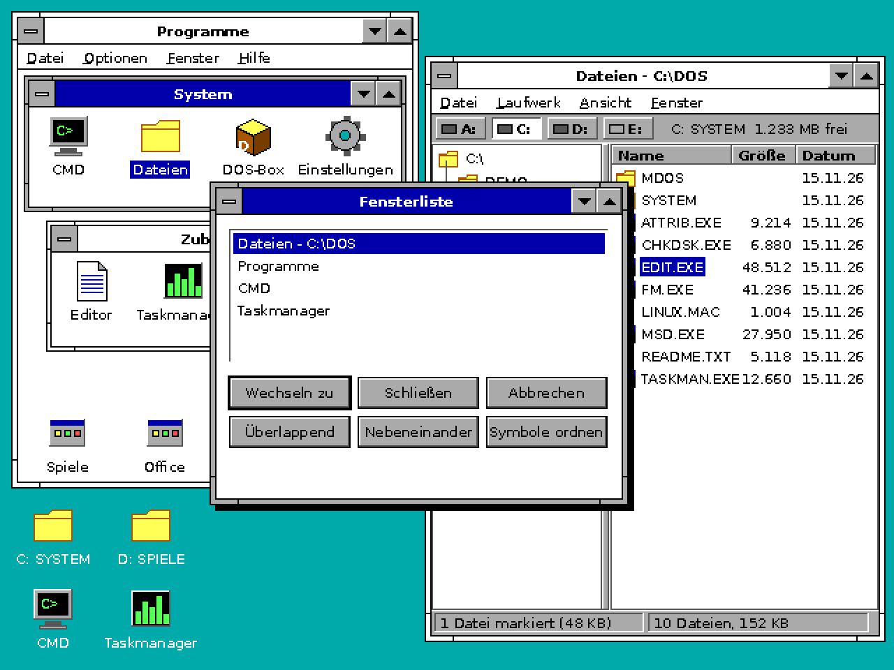

<!-- SPDX-License-Identifier: GPL-2.0-or-later -->
# Plan: Grafische Oberfläche und Win16 für AT-DOS

Stand: 15.11.2026, abgestimmt mit dem Nutzer; Stil/Shell austauschbar
nachgetragen 25.11.2026. Erster Code (GUI-Prozess, KERNEL/USER/GDI für
Win16) seit 25.11.2026, siehe „Stand: GUI-Prozess“.

## Entscheidungen

- **Win16 nativ** ist die Schnittstelle der GUI. Alte Windows-3.x-Programme
  laufen direkt auf AT-DOS, ohne echtes Windows 3.1 (auch nicht in einer
  DOS-Box). Win16-Programme sind 16-Bit-Protected-Mode-Programme im
  NE-Format und passen zum Kernel (LDT je Task, Selektoren, 286-Code).
- **Die ganze Win16-Schicht läuft auch unter AT-DOS 5.x**: 286-Code,
  kooperativ, ohne Paging/V86. Auf 5.x bleibt „Programme bleiben 286“.
- **Eigener Prozess**: Die GUI wird bei Bedarf gestartet (`GUI` aus CMD,
  wie `startx`), läuft in einer eigenen Grafiksitzung, Alt+Esc führt zu
  CMD und den Boxen. Beendet sich die GUI, beendet sie ihre Programme.
  Startet man ein Win16-Programm aus CMD, startet die GUI mit.
- **Kein GUI-Code im Kernel** (DGROUP ist voll). Der Kernel liefert nur
  die Grundlagen (NE-Lader, DLLs, IPC).

## Aufbau

- Wie PM 1.x und Windows 3.x, nicht wie X: kein Protokoll je Zeichen-
  aufruf (auf dem 386 zu teuer). Der GUI-Prozess besitzt Bildschirm,
  Fensterliste und Eingabe; USER und GDI sind DLLs mit gemeinsamen Daten,
  jedes Programm zeichnet unter einer Sperre selbst in den Bildspeicher.
- Grafiktreiber als DLL mit IOPL-Segment im Ring 2 (wie OS/2 1.x) – geht
  auf 286 und 386 gleich, Programme bleiben im Ring 3.
- Beim Sitzungswechsel wird das Bild nicht gesichert, die GUI zeichnet
  alle Fenster neu (480 KB bei 800×600×256 wären auf 2 MB zu viel).

### Verzeichnisse im Repository (abgestimmt 25.11.2026)

Eigenes Verzeichnis `gui/` auf oberster Ebene (neben `apps/`, `drivers/`,
`atdoscm/`):

```
gui/
  kernel/   KERNEL.EXE-Ersatz für Win16 (Exporte, Speicher, Module)
  user/     USER: Fenster, Nachrichten, Steuerelemente, Dialoge
  gdi/      GDI-Kern: Zeichnen, Clipping, Schriften
  style/    cua/, mini/ (fvwm2), w95/ – austauschbare Stile
  shell/    Programm-Manager-Art, Taskleiste, Dateimanager, Pager
  drv/      Grafiktreiber: vga/, et4000/, gd5434/, trio3d/
  res/      eigene Symbole, Bitmaps, Systemschrift
  include/  gemeinsame Header (Win16-Typen, Treiberschnittstelle DDI)
```

Der NE-Lader mit DLLs ist eine Grundlage des Kernels und kommt nach
`kernel/`, nicht nach `gui/`. build.sh bekommt einen eigenen Abschnitt
für die GUI (wie beim Netzwerk). Entwürfe und Bilder bleiben unter
`docs/gui/`.

### Kernel-Grundlagen (Stufe 0, für 5.x und 6.0)

1. NE-Lader mit DLLs: gemeinsamer Code, gemeinsame Datensegmente,
   Importe über Ordinalzahl/Namen. Open Watcom linkt NE direkt
   (`format windows`, `format os2`) – auch für die eigenen GUI-Programme.
2. IPC: Semaphoren, gemeinsamer Speicher; Threads später.

### Stand: NE-Lader Stufe 1 (25.11.2026, nur `main`)

Variante A (Entscheidung des Nutzers): DLL-Selektoren wie OS/2 1.x –
von oben in der LDT, in allen Tasks gleich; die gemeinsame LDT für
Win16 (Frage 1 unten) kommt später darauf.

- `kernel/neload.c` (KTEXT4, ~6 KB Code): `load_program` nimmt NE, wenn
  `load_image` „kein FX“ meldet; `dos_kind` hält NE nicht mehr für ein
  DOS-Programm (vorher lief der MZ-Stub „This is an OS/2 executable“ in
  der Box).
- EXE: Segment k -> LDT-Eintrag k + 1 (ab 2), Autodata mit Heap und
  Stapel (SS:SP 0 -> Stapel am Ende des Autodata wie OS/2), Start
  CS:IP/SS:SP/DS aus dem Kopf, Merker „lange Namen“ aus Byte 37h.
- DLL: einmal geladen in einer Modultabelle (Kernelsegment `ne_sel`, bis
  15 Module zu je 32 Segmenten, 8 Abhängigkeiten, Einsprung- und
  Namenstabelle). Selektoren aus `ne_sh` (Bitmap) von oben, frei in allen
  laufenden Tasks; jeder Task bekommt Alias-Einträge (`D_ALIAS`, gibt
  seg_free nicht frei), `ldt_free` in DosAllocSeg/VioGetBuf überspringt
  sie. Gesucht wird im Verzeichnis des Programms, dann `\DOS\SYSTEM`
  und `\DOS` des Startlaufwerks (`NAME.DLL`). Zähler je Modul
  (`task.nemods`); mit dem letzten Benutzer wird die DLL freigegeben.
- Relokationen: intern, Import über Ordinalzahl und Namen (resident und
  nicht resident), Typen LOBYTE/SEGMENT/FAR_ADDR/OFFSET, Ketten und
  ADDITIVE; Einsprungtabelle fest und beweglich.
- Fehlt eine DLL: `EXEC_ERR_DLL` (5), CMD meldet „Bibliothek (DLL)
  fehlt oder passt nicht“, Name im DMESG („NE: DLL nicht geladen“).
- Geprüft in QEMU mit Watcom-Programmen (`format os2`, DLL mit
  `__loadds` – ohne lädt Watcom DS nicht): Aufrufe über Ordinalzahl und
  Namen, Daten der DLL (Segmentrelokation auf DGROUP), zwei Tasks
  gleichzeitig teilen die DLL und ihre Daten (6 -> 7 -> 8), nach dem
  Ende freigegeben (MEM nach 40 Läufen gleich), fehlende DLL gemeldet;
  CMD, Box, DOS-Programme unverändert. Reine Programmlogik, kein 86Box.

### Stand: NE-Lader Stufe 2 (25.11.2026)

- **DLL-Start**: die Startroutinen (CS:IP im Kopf der DLL) laufen im
  Ring 3 vor dem Programm, Abhängigkeiten zuerst. Ein Stummel (40 Byte,
  gemeinsamer LDT-Eintrag `ne_stub`, für immer) arbeitet eine Liste ab,
  die der Lader unter SS:SP der EXE legt (je DLL Kennung, DS, Heap, IP,
  CS; dann 0 und DS:IP:CS der EXE). Register wie OS/2 1.x und Windows:
  AX = Modulkennung, CX = Heap, DS = ES = DI = Autodata. Gibt eine
  Routine AX = 0 zurück, endet das Programm mit 255 vor `main`. Global
  nur beim ersten Laden; je Task mit INITINSTANCE (Kopfbit 4) oder bei
  Instanzdaten.
- **Instanzdaten** (MULTIPLEDATA, Kopfbit 2): Autodata und nicht geteilte
  Datensegmente (ohne Segmentbit 20h) bekommt jeder Task als Kopie der
  geladenen Vorlage unter demselben Selektor (kein Alias – task_end gibt
  sie wie DosAllocSeg frei).
- **Ressourcen**: FAPI 64h `DosGetResource(h, Typ, Kennung)` liest aus
  der Ressourcentabelle des Programms (h = 0) oder einer DLL in ein neues
  Segment; FAPI 65h `DosGetModHandle(Name)` liefert die Kennung (Platz in
  der Modultabelle + 1, dieselbe wie AX beim DLL-Start). Nur Zahlen als
  Typ und Kennung (OS/2); Namen als Kennung (Win16) fehlen noch.
- Geprüft in QEMU (Watcom `format os2`, `initglobal`/`initinstance`,
  `manyautodata`, Ressourcen mit `wrc -bt=os2` und `op resource=`): eine
  globale DLL und eine MULTIPLEDATA-DLL in zwei Tasks gleichzeitig –
  globaler Start einmal, Instanzstart je Task, Zähler je Task getrennt;
  Ressourcen aus EXE und DLL, fehlende Kennung FFFFh; Start mit AX = 0
  -> ERRORLEVEL 255; MEM nach 10 Läufen gleich. KTEXT4 danach 53.123
  Byte.
- Noch nicht: Namen als Ressourcenkennung, DosLoadModule (DLL zur
  Laufzeit), Win16-Module (KERNEL/USER/GDI als eigene DLLs),
  Startregister der EXE wie OS/2 (AX = Umgebung, BX = Befehlszeile),
  Auslagern/Verwerfen von NE-Code (Code wird wie Daten behandelt), 5.x.

### Stand: GUI-Prozess (25.11.2026, Auftrag „mach mit dem kompletten Plan weiter“)

**Entscheidung zu Frage 1 (gemeinsamer Adressraum):** wie Windows 3.x im
Standard-Modus – *ein* AT-DOS-Task `GUI.EXE` mit *einer* LDT, darin alle
Win16-Programme als kooperative Tasks (Wechsel nur in GetMessage/
PeekMessage/Yield, je Task eigener Stapel im eigenen Autodata). Grund:
der Kernel hat nur 8 Tasks (NTASK, Kernelstapel in DGROUP), ein Task je
Win16-Programm wäre zu eng; Win16 ist ohnehin kooperativ, und GMEM_SHARE,
DDE und Zwischenablage brauchen den gemeinsamen Adressraum. Gegenüber CMD
und den Boxen bleibt die GUI präemptiv. Wie bei Windows 3.x reißt ein
abstürzendes Win16-Programm die GUI mit.

Aufbau (`gui/`, gebaut in build.sh Abschnitt „GUI (Win16)“):

- `GUI.EXE` – NE (`format os2`, Modell medium, `-zu`: SS ≠ DS, weil die
  Exporte auf dem Stapel des Programms laufen). Kein Code aus der Watcom-
  Bibliothek (32-Bit-Mul/Div in `gcrt.asm`).
- `w16ldr.c` – NE-Lader im Ring 3: Segmente per DosAllocSeg, Code danach
  per `FAPI_SEGCTL` (66h) `SEG_TOCODE`, Relokationen (intern, Ordinal,
  additiv, Ketten), Importe aus KERNEL/USER/GDI über `exports.c`, die
  Tabellen erzeugt `tools/mkexp.py` aus den mit `API` markierten
  Funktionen und `gui/ordinals.txt` (Nummern von Windows 3.1 aus den
  Importbibliotheken von Open Watcom). Fehlt ein Import: Eintrag in
  `GUI.LOG`, Aufruf beendet das Programm. Ressourcen (FindResource-Art,
  LoadString).
- `krnl.c` – Tasks (`tsw`/`tstart` in gcrt.asm, InitTask mit Registern
  wie Windows, PSP, Autodata: Daten, Stapel, lokale Halde), Global* (ein
  Segment je Block, Handle = Selektor), Local* (Halde im Autodata des
  Aufrufers – DS aus dem `__loadds`-Rahmen), `_lopen` & Co., INT 21h der
  Programme: der Kernel leitet INT n aus Ring 3 an den Handler des
  Programms (`SEG_INTHND`, `ne_r3int` in neload.c über dpmi_trap),
  `dos_int` übersetzt in FAPI-Aufrufe (Dateien, Suche, Verzeichnisse,
  Datum/Zeit, Laufwerke, 4Ch).
- `gdi.c` – VGA 640×480×16 über VioSetGfx(12h): Schattenbild in vier
  Ebenen, `gdi_flush` bringt den geänderten Bereich auf die Karte; der
  Mauszeiger wird vom GUI-Prozess selbst gezeichnet (der Zeiger des
  Kernels stellte beim Überzeichnen alte Punkte zurück). Palette = die 16
  Grundfarben von Windows, RGB auf die nächste. Objekte (Stift, Pinsel,
  Schrift), DCs mit Clipping-Rechtecken, TextOut/ExtTextOut, Linien,
  Rechteck, Ellipse, PatBlt, Pixel. Schrift vorerst 8×16 aus
  `\DOS\SYSTEM\CP850.FNT` (FreeDOS cpidos, GPL), ANSI auf 850 umgesetzt –
  eine eigene Systemschrift fehlt noch.
- `user.c` – Fenster (CUA-Rahmen eigen: Systemfeld, Titel, Pfeilknöpfe,
  Eckmarken), Klassen, Nachrichten je Task, WM_PAINT/WM_TIMER beim
  Abholen, SendMessage über Tasks hinweg durch die Hauptschleife,
  Verschieben mit Umriss, Aktivieren, Alt+F4, Doppelklick aufs
  Systemfeld, eingebaute Klassen BUTTON und STATIC, MessageBox (modal).
- Beispiel `\DEMO\HALLOW.EXE` (`gui/demo/`, eigener Startcode
  `w16crt.asm`, Importe per `tools/w16imp.py`, ohne Watcom-Bibliothek).

Geprüft in QEMU (`GUI \DEMO\HALLOW`; ebenso ein mit der Watcom-Win16-
Bibliothek gebautes Programm, nur im Scratchpad): Fenster mit Text und
Rechteck, Klick -> MessageBox -> OK, Verschieben am Titel, Alt+F4 beendet,
GUI endet, CMD macht weiter. In 86Box geprüft (386DX/40, 4 MB, Cirrus
GD5434, AHA-154x, serielle Maus): dasselbe. Dabei behoben: Alt+F4 ging
bei schnellem Tippen verloren – der Kernel liefert Alt+F-Taste als
Scancode, Alt war beim Abholen schon los; jetzt merkt sich kbd.c die
Umschalttasten je Taste im Puffer, `FAPI_KBDSHIFT` mit BX = 1 liefert sie
für die zuletzt geholte. Lehren: CLI im Ring 3 ist #GP (Stapelwechsel
in `tsw` ohne CLI – MOV SS sperrt den nächsten Befehl); ein Task darf sein
Autodata nicht selbst freigeben, solange er darauf läuft (`task_reap` in
der Hauptschleife); WinMain ist im Modell small ein naher Aufruf.

Schriften: `COREFONT.EXE` installiert die „Core fonts for the Web“ von
Microsoft (Arial, Times New Roman, Courier New, Verdana, Georgia …) wie
Debians `ttf-mscorefonts-installer` – Pakete von SourceForge, SHA-256 wie
bei Debian, eigener LZX-Entpacker, Ziel `\DOS\FONTS`. Sie kommen nie ins
Repository und nicht auf die Disketten (Lizenz: nur unverändert weiter-
geben). Benutzt werden sie, sobald der TrueType-Rasterer steht.

### Stand: Notepad (25.11.2026)

Ziel 1 erreicht: **Notepad aus Windows 3.1 (deutsch)** läuft – Datei
öffnen über die Befehlszeile und den Öffnen-Dialog, Tippen, Markieren,
Ausschneiden/Kopieren/Einfügen, Rückgängig, Zeilenumbruch, F5 (Uhrzeit),
Suchen, Speichern und Speichern unter (CR LF), Rückfrage beim Beenden.
Neu dafür (Module jetzt KERNEL, USER, GDI, KEYBOARD, COMMDLG, SHELL;
`tools/mkexp.py` kennt `APIC` für cdecl wie wsprintf):

- `menu.c` – Menüs aus Ressourcen und per Create/Append/Insert/Modify,
  Menüleiste, Aufklappmenüs, Alt/F10/Alt+Buchstabe/Pfeile/Maus,
  WM_INITMENU(POPUP), Häkchen, gesperrte Einträge, Tastenkürzel
  (LoadAccelerators/TranslateAccelerator).
- Bildlaufleisten im Fensterrahmen (WS_VSCROLL/WS_HSCROLL, Pfeile,
  Seitenweise, Ziehen, Wiederholung).
- `edit.c` – EDIT-Steuerelement (ein- und mehrzeilig, Text in der lokalen
  Halde des Programms, EM_GETHANDLE/EM_SETHANDLE, Umbruch, Markierung,
  eine Stufe Rückgängig, alle EM_*-Nachrichten, die Notepad braucht);
  Zwischenablage CF_TEXT über DosClipPut/Get (ANSI <-> OEM).
- `dlg.c` – Dialoge aus Ressourcen (modal und nicht modal),
  IsDialogMessage (Tab, Enter, Esc, Alt+Buchstabe), BUTTON (Druck-,
  Kontroll-, Optionsknopf, Gruppe), STATIC, LISTBOX.
- `commdlg.c` – GetOpenFileName/GetSaveFileName (eigener Dialog mit
  Dateiliste, Verzeichnissen und Laufwerken), FindText; PrintDlg & Co.
  melden „nicht vorhanden“.
- `misc.c` – AnsiToOem/OemToAnsi, wsprintf/wvsprintf,
  RegisterWindowMessage, ShellAbout, WinHelp (nur Hinweis), TabbedTextOut.
- Lokale Halde mit **verschiebbaren Griffen** wie LMEM_MOVEABLE:
  Grifftabelle in der Halde (Eintrag = Stelle des Blocks + Sperrzähler),
  LocalLock liefert die Stelle, LocalReAlloc verschiebt den Block und
  lässt den Griff gleich. Notepad hält sich den Griff aus EM_GETHANDLE –
  mit festen Griffen stand nach dem Vergrößern Haldenmüll in der Datei.
- Je Task ein Umgebungsblock (PSP:2Ch: leere Umgebung, Zähler,
  Programmpfad); InitTask liefert die Befehlszeile ohne führende
  Leerzeichen wie Windows.
- Tasten bleiben im Kernelpuffer, solange die Schlange der Ziel-Task
  keinen Platz für KEYDOWN/CHAR/KEYUP hat (Schlange 48 Nachrichten) –
  auf dem 386 gingen bei schnellem Tippen Zeichen verloren.
- Kernel: FAPI_SEGCTL `SEG_REALLOC` kopierte Worte statt Bytes (die
  Halde verlor beim Wachsen die obere Hälfte).

Geprüft: QEMU (16 und 4 MB) und 86Box 386DX/40 mit 4 MB, Cirrus GD5434,
AHA-154x, serielle Maus: Start mit Datei, Tippen mit 30 ms je Taste ohne
Verlust, Menü, Speichern, Beenden, Inhalt byte-genau, fsck sauber.
Notepad nur aus der Windows-Kopie des Nutzers zum Testen, nie im
Repository. Lehren: QEMU lässt Zugriffe über den Nullselektor durch (ES =
0 aus PSP:2Ch fiel erst in 86Box auf); `get_bp2()` liest `[bp+2]` als DS
des Aufrufers und gilt nur, wenn die Exportfunktion vor BP nichts weiter
sichert – in den Exporten erst `WORD ds = get_bp2();`, die Arbeit in eine
Hilfsfunktion; `MKFP(s, o)` braucht den `:>`-Operator.

Noch nicht: Bitmaps/BitBlt, eigene Schriften (TrueType), DLLs von
Programmen (LoadLibrary), Profile (INI), Größe ändern/Minimieren, Drucken,
Shell, weitere Grafiktreiber. Nächste Ziele: Write, danach (Wunsch des
Nutzers, 25.11.2026) **PROGMAN** aus Windows 3.1 als Spaß-Ziel – braucht
Profile/INI, Gruppen-Dateien, Symbole (Icons), MDI und WinExec.

### Stand: osFree-Programme als Prüfstand (25.11.2026)

Gebaut nur im Scratchpad (`wcc -bt=windows -ms -zW`, Clock mit `-fpi87`,
`wlink system windows` mit den EXPORTS aus ihren makefiles; PROGMAN:
`LANGUAGE`-Zeilen in Dialogen entfernt – der Watcom-RC nimmt sie für
Win16 nicht an). Laufen jetzt: osFree-Notepad, Reversi, Winver, Taskman,
Minesweeper (spielbar), Clock (analog). Dafür neu:

- **Stufe 1:** SetErrorMode, lstrcpyn, LoadLibrary/FreeLibrary (eingebaute
  Module; DLLs von Programmen noch nicht -> 2), WinExec (Win16 als neue
  Task), GetKBCodePage, GetTextExtentPoint, Start/EndPage (Fehler),
  EnumWindows/EnumTaskWindows/EnumChildWindows, GetLastActivePopup,
  SwitchToThisWindow, Get/SetCursorPos, ShowCursor, AdjustWindowRect,
  SystemParametersInfo (lesen). LISTBOX: LB_DELETESTRING mit ungültigem
  Index gibt LB_ERR (Taskman leert die Liste in einer Schleife bis dahin
  – vorher endlos).
- **Stufe 2, GDI mit Bitmaps:** alle Zeichenroutinen arbeiten auf einer
  Zielfläche (Bildschirm-Schatten oder Bitmap im selben Ebenenformat:
  1 Ebene einfarbig, 4 Ebenen 16 Farben, ein Segment bis 64 KB);
  CreateCompatibleDC/Bitmap, CreateBitmap(Indirect), Set/GetBitmapBits
  (einfarbig), LoadBitmap (DIB 1/4/8/24 Bit), BitBlt/StretchBlt mit allen
  256 ROPs (Ternärcode Bit für Bit, einfarbig <-> Farbe wie Windows);
  Abbildungsmodi (Fenster-/Viewport-Ursprung und -Ausdehnung, ISOTROPIC/
  ANISOTROPIC, feste Einheiten bei 96 dpi), DPtoLP/LPtoDP; Polygon füllt
  mit dem Pinsel (Gerade-Ungerade).
- Fehler bei osFree selbst (nicht bei uns): Notepad überspringt das erste
  Wort der Befehlszeile (erwartet den Programmnamen wie Win32), Reversi
  setzt seine Textzeile über den Clientbereich.
- OSFIXUP-Einträge (Gleitkomma-Emulator) überspringt der Lader wie Wine:
  benutzt wird die echte FPU. WIN87EM (`__fpmath`) fehlt noch.

- **Stufe 3, PROGMAN:** MDI in `gui/mdi.c` – interne Klasse MDICLIENT
  (Hintergrund in der Farbe APPWORKSPACE, WM_MDICREATE/DESTROY/ACTIVATE/
  GETACTIVE/NEXT/MAXIMIZE/RESTORE/TILE/CASCADE/SETMENU, Fensterliste im
  Fenstermenü), DefFrameProc, DefMDIChildProc; Geschwister haben eine
  Reihenfolge (z), überdeckte werden ausgespart und nach dem Malen des
  Elternfensters neu gezeichnet; Kinder lassen sich an ihrer Titelleiste
  ziehen. Symbole in `gui/icon.c`: LoadIcon (RT_GROUP_ICON -> passendes
  RT_ICON), CreateIcon, DestroyIcon, DrawIcon (UND-, dann XOR-Maske),
  ExtractIcon aus NE-Programmen und `.ICO`. INI-Dateien in `gui/ini.c`:
  Get/WritePrivateProfileString/Int, WIN.INI, Windows-Verzeichnis =
  `%WINDIR%` oder `X:\DOS\GUI`. WinExec aus einer laufenden Task springt
  jetzt direkt in die neue Task (vorher überschrieb `task_run` den
  gesicherten Stapel der Hauptschleife – #GP beim nächsten `pop ds`).
  osFree-PROGMAN (mit `-ml` gebaut – er übergibt `&cs` als nahen Zeiger
  an CreateWindow, im kleinen Modell falsch): Gruppe anlegen, Programm
  eintragen, Minesweeper per Enter starten – in QEMU geprüft.
  Nach dem ersten Test des Nutzers in 86Box (25.11.2026): Fenster lassen
  sich minimieren (Symbol mit dem Klassensymbol unten auf dem Bildschirm
  bzw. im MDI-Client, Doppelklick stellt wieder her), maximieren (Knopf
  wird zu Wiederherstellen; MDI-Kinder über WM_MDIMAXIMIZE) und haben ein
  Systemmenü (Klick aufs Feld, Alt+Leertaste; Wiederherstellen,
  Minimieren, Maximieren, Schließen, bei MDI-Kindern Nächstes –
  Verschieben/Größe per Tastatur noch grau). Dazu TrackPopupMenu,
  IsIconic/IsZoomed. Programme bekommen 8 KB mehr Stapel als im NE-Kopf
  (USER/COMMDLG laufen auf ihrem Stapel; PROGMAN meldete bei Neu →
  Programm → Durchsuchen „Stack Overflow“). Die Shell (und jedes
  Programm ohne Pfad) wird auch im Windows-Verzeichnis und im PATH
  gesucht. Dass neue Gruppen nach dem Neustart fehlen, liegt am
  osFree-PROGMAN: er schreibt die .GRP-Datei, trägt sie aber nie in
  `[Groups]` der PROGMAN.INI ein.
  `GUI` ohne Programm startet wie Windows die Shell aus `[boot] shell=`
  der SYSTEM.INI im Windows-Verzeichnis (Vorgabe PROGMAN.EXE; Anregung
  des Nutzers).
  Offen: Symbol der Einträge (osFree ruft ExtractIcon dafür nicht),
  DLLs von Programmen, WIN87EM.

### Stand: Standarddialoge auf den Vorlagen von Wine (25.11.2026)

Vorschlag nach der Frage des Nutzers, ob ReactOS für die Dialoge taugt:
der Code von ReactOS/Wine ist 32-Bit-Win32 und passt nicht, wohl aber
die **Vorlagen** der alten Dialoge im Stil von Windows 3.1 aus Wine
`dlls/comdlg32/comdlg32.rc` (OPEN_FILE, SAVE_FILE, PRINT, PRINT_SETUP,
CHOOSE_FONT, CHOOSE_COLOR, FINDDLGORD, REPLACEDLGORD; LGPL-2.1-or-later,
unter GPL-2.0-or-later weitergegeben). `gui/res/commdlg.rc` = diese
Dialoge mit den deutschen Texten aus Wine `po/de.po` (vier geändert, weil
unsere Schrift 8 Punkte breit ist), Herkunft im Kopf der Datei.
`tools/rc2dlg.py` macht beim Bauen 16-Bit-DLGTEMPLATEs daraus
(`build/cdlgtpl.h`, `__far` – eigenes Datensegment, DGROUP von GUI.EXE
hat nur noch ~2 KB frei); OWNERDRAW-Listen werden gewöhnliche.
Größe und Steuerelement-Nummern sind die von Windows, also funktionieren
auch eigene Vorlagen (`ENABLETEMPLATE[HANDLE]`) und Hooks (`ENABLEHOOK`:
der Hook bekommt jede Nachricht zuerst, WM_INITDIALOG mit der Struktur).

Dafür neu: **COMBOBOX** (`gui/combo.c`) – SIMPLE, DROPDOWN, DROPDOWNLIST;
die Einträge hält immer ein LISTBOX-Fenster (Kind bzw. verborgenes Popup),
aufgeklappt wird es wie ein Menü verfolgt (`track_on`/`track_off` in
menu.c, Maus/Tasten als MT_*); CB_* wie Win16 (WM_USER + n), CBN_* an den
Elternteil. LISTBOX kann jetzt LB_GET/SETITEMDATA und LB_FINDSTRINGEXACT,
`NLB` 16. `IsDialogMessage` nimmt Enkel (das Feld in einer COMBOBOX).
Lehren: ein Popup bekommt in CreateWindowEx im Menü-Feld 0, sonst rechnet
calc_client eine Menüzeile ab; Popups, die beim Anlegen eines Dialogs
entstehen, liegen nach dem Aktivieren des Dialogs unter ihm
(`wnd_raise` vor dem Zeigen).

Umgestellt: Öffnen/Speichern (Dateityp- und Laufwerksliste, Schreibschutz,
Hilfe nur mit OFN_SHOWHELP), Suchen, Ersetzen (neu). In QEMU geprüft:
Notepad öffnet über den Dialog, Laufwerk per Klappliste (leeres CD:
„Laufwerk nicht bereit“), Suchen findet; osFree-PROGMAN Durchsuchen mit
seinem Typfilter.

Danach Farbe, Schriftart und Drucken: **ChooseColor** mit den 48
Grundfarben wie Windows 3.1 (Werte aus Wine colordlg.c), 16 eigenen,
„Farben definieren >>“ verbreitert den Dialog (Farbfeld Ton/Sättigung,
Helligkeitsleiste, Rot/Grün/Blau und Ton/Sättigung/Helligkeit in der
Windows-Skala 0–240, gegenseitig umgerechnet); gemalt wird in WM_PAINT des
Dialogs, die STATIC-Platzhalter der Vorlage sind verborgen. Bei 16 VGA-
Farben mischen Farbfelder zeilenweise die nächste Farbe mit einer
Ausgleichsfarbe. **ChooseFont**: es gibt nur die Systemschrift – Liste
„System“, Stile Standard/Kursiv/Fett/Fett Kursiv, Größen 8–72 (nach Zahl,
CF_LIMITSIZE), Darstellung und Farbe (16 Namen) mit CF_EFFECTS, Muster;
füllt LOGFONT (Höhe für 96 dpi), iPointSize, rgbColors, nFontType.
Pfeiltasten im Feld einer COMBOBOX blättern deren Liste (edit.c reicht sie
weiter). **PrintDlg** meldet „kein Drucker eingerichtet“ (PDERR_NODEFAULTPRN,
ohne Meldung bei PD_NOWARNING/PD_RETURNDEFAULT) – Druckertreiber der
Oberfläche gibt es noch nicht. Geprüft in QEMU mit einem Testprogramm
(Scratchpad): Blau gewählt -> 0xFF0000, 11 pt fett unterstrichen -> 110/700,
Drucken -> 1008h.

### Stand: Write (25.11.2026; läuft seit 26.11.2026)

WRITE.EXE aus Windows 3.1 (deutsch, aus der Kopie des Nutzers, nur im
Scratchpad) lädt und läuft bis in WM_CREATE seines Hauptfensters, meldet
dann aber „Nicht genügend Arbeitsspeicher verfügbar“. Write wird nicht
zerlegt (Microsoft-Code); gesucht wird nur von unserer Seite aus.

Dafür neu bzw. behoben:
- **Lader**: Segmenttabelle je Modul in einem eigenen Segment statt fest
  24 Einträgen (Write hat 84 Segmente).
- **OLECLI** (`gui/ole.c`, OLE 1.0 ohne Server): Dokumente an-/abmelden
  geht, Objekte anlegen/laden meldet OLE_ERROR_GENERIC, die
  Zwischenablage hat nie ein Objekt. Registrierungsdatenbank in SHELL
  (RegOpenKey & Co.) leer (ERROR_BADKEY).
- KERNEL: Atome (eine Tabelle für lokale und globale, C000h + Platz),
  GetTempFileName/GetTempDrive (%TEMP%), GetInstanceData,
  **LocalHandleDelta** (KERNEL.310 – Write holt sie per GetProcAddress
  und ruft sie ungeprüft: vorher #GP bei Aufruf nach 0000:0000),
  LocalCompact liefert den größten freien Block samt Wachstum bis 64 KB,
  GlobalReAlloc mit GMEM_MODIFY ändert die Größe nicht mehr.
- Lokale Halde wie Windows auf 4 Byte ausgerichtet, Griffe verschiebbarer
  Blöcke haben Bit 1 gesetzt (Write benutzt Griffe direkt, ohne
  LocalLock).
- GDI: **TEXTMETRIC lag ab Byte 19 um eins verschoben** (tmLastChar war
  20h, Zeichensatz 30h – betraf jedes Programm mit GetTextMetrics),
  EnumFonts meldet die Rasterschriften von Windows 3.1 (System, MS Sans
  Serif, MS Serif, Courier, Small Fonts, Symbol, Terminal; gezeichnet
  wird weiter mit der Systemschrift), GetDeviceCaps vollständig (ASPECTX/
  Y, Fähigkeiten), MulDiv, SelectClipRgn(NULL), CreateIC, GetCharWidth,
  SetStretchBltMode, SetTextJustification, PlayMetaFile (ohne Wirkung).
- USER: GetSystemMetrics vollständig (vorher 0 u. a. für
  SM_CXFULLSCREEN, SM_MOUSEPRESENT), CREATESTRUCT.hMenu = geladenes
  Klassenmenü, nach WM_CREATE auch WM_MOVE (nur Kind-/Popup-Fenster, s. u.), GetUpdateRect, ScrollDC (meldet
  den ganzen Bereich als neu zu zeichnen), ChangeMenu (Windows 2.x),
  RegisterClipboardFormat, FlashWindow, InSendMessage, GetCaretBlinkTime;
  MessageBox bricht lange Zeilen an Wortgrenzen um. KEYBOARD: VkKeyScan.

**Aufrufspur** (Werkzeug für alle weiteren Programme): `SET GUITRACE=1`
vor `GUI` – jeder Import läuft dann über einen Vorschaltcode (24 Byte je
Import, eigenes Segment je Modul, danach Code), der Modul und Nummer in
einen Ring von 128 Einträgen schreibt; INT-21h-Aufrufe der Programme
kommen als `F000h|AH` dazu. Vor jeder MessageBox steht der Ring im
GUI.LOG („Aufruf (Modul<<12|Nummer)“, Modul 1 KERNEL, 2 USER, 3 GDI,
4 KEYBOARD, 5 COMMDLG, 6 SHELL, 7 OLECLI; Namen in `gui/ordinals.txt`).

Die Spur schreibt auch die Rückgaben mit (DX:AX je Aufruf, „AX …/DX …“
unter dem Eintrag): der Vorschaltcode biegt den Rücksprung ins Programm
über `tr_post` um (Schattenstapel je Task 32 tief, Tabellen in einem
eigenen Segment `tr_dseg`, nur bei GUITRACE – DGROUP von GUI.EXE ist
voll); je Task, weil ein Aufruf in einen anderen Task wechseln kann
(ShellExecute startet ein Programm, GetMessage gibt ab) – mit einem
gemeinsamen Stapel kehrte GetMessage von Notepad mit dem Rücksprung von
PROGMAN zurück (Müll als Nachricht, Hänger nur mit GUITRACE);
Catch/Throw (KERNEL 55/56) ohne Rückgabe. F12 schreibt die Spur jederzeit
ins GUI.LOG; erfolglose PeekMessage-Aufrufe und INT 21h 2Ch (Leerlauf)
kommen nicht in den Ring.

Write läuft seit 26.11.2026 (in QEMU geprüft: Start, Menüs Datei/
Bearbeiten, Tippen mit Schreibmarke und Endmarke). Gefunden mit der Spur:
1. **INT 21h 47h** (aktuelles Verzeichnis) muss wie MS-DOS bei Erfolg
   AX = 0100h liefern (undokumentiert, Wine tut es ebenso) – Write prüft
   den Wert; mit dem alten AX meldete es „Nicht genügend
   Arbeitsspeicher“ (der Hinweis aus Wine-Bug 19494, Verzeichnis, führte
   dorthin: Write fragt dort mit AX = 4743h, DL = 3).
2. Steuerelement **SCROLLBAR** fehlte (Write legt seine Bildlaufleisten
   als eigene Fenster an): jetzt Klasse `SCROLLBAR` in user.c
   (`sbctl_proc`, SBS_VERT/SBS_SIZEBOX, Meldungen WM_xSCROLL an das
   Elternfenster mit dem eigenen Griff in HIWORD(lParam), SB_CTL in
   Set/GetScrollPos/Range, ShowScrollBar).
3. **WM_SIZE/WM_MOVE**: Hauptfenster bekommen sie erst beim ersten
   ShowWindow (wie Windows, Wine `WIN_NEED_SIZE`), Kind- und Popup-Fenster
   gleich nach WM_CREATE – Writes WM_SIZE bewegte sonst Kindfenster, die
   es noch nicht gab.
4. **Gehaltene DCs**: Write holt den DC seines Dokumentfensters einmal
   beim Start (noch unsichtbar) und zeichnet später damit – Ursprung und
   Clip stammten aus dieser Zeit (leerer Clip, Text unsichtbar). Jetzt
   zählt `win_gen` jede Änderung an Lage, Rang und Sichtbarkeit; ein DC
   außerhalb von BeginPaint rechnet beim nächsten Gebrauch Ursprung und
   Clip neu (`dptr`, gdi.c). Ein mit IntersectClipRect verkleinerter Clip
   geht dabei verloren.
5. INT 21h 43h (Attribute lesen/setzen) im Win16-DOS.

Offen: Write zeichnet mit der Systemschrift (keine echten Schriftgrößen),
Drucken (kein Drucker), OLE-Objekte, CS_OWNDC als echter Klassen-DC
(Einstellungen bleiben bei uns nur im gehaltenen DC).

### Stand: PROGMAN aus Windows 3.1 (26.11.2026)

Der Programm-Manager aus Windows 3.1 (deutsch, aus der Kopie des Nutzers,
nur im Scratchpad als MSPM.EXE) läuft – in QEMU geprüft: Start (leer, ohne
PROGMAN.INI), Datei → Neu → Programmgruppe „Test“, Datei → Neu →
Programm (Notepad, Befehlszeile `notepad.exe`), das Symbol kommt aus
NOTEPAD.EXE, Enter startet Notepad; Windows beenden (Alt+F4, OK), danach
erneut gestartet: PROGMAN.INI (im Windows-Verzeichnis) nennt TEST.GRP,
die Gruppe kommt samt Symbol aus der Datei. Nichts zerlegt, gefunden mit
der Aufrufspur.

Dafür neu (rund 40 Funktionen fehlten, `gui/user2.c` neu):
- USER: GetWindow (Geschwister nach Rang), Get/SetWindowPlacement,
  Schreibmarke (CreateCaret/SetCaretPos/Show/Hide/DestroyCaret –
  invertiertes Rechteck ohne Blinken), ScrollWindow (verschiebt die
  Kinder, zeichnet neu), InvalidateRgn, DrawFocusRect, GrayString (nur
  Text), SetWindowsHook/DefHookProc (angenommen, nie gerufen),
  ExitWindows (WM_QUERYENDSESSION an alle oberen Fenster, dann Ende aller
  Tasks), IsCharAlpha(Numeric), AnsiUpperBuff, CopyIcon, DumpIcon,
  SetSysModalWindow, DragObject, CalcChildScroll (ohne Wirkung),
  GetInternalIconHeader (Stummel).
- **Symbole sind Speicherblöcke wie unter Windows**: der Griff ist der
  Selektor eines Segments im Format CURSORICONINFO (12 Byte Kopf,
  AND-Maske, Farbteil 4 Bit gepackt; `gdi_bm4`). PROGMAN holt die Bits
  über LockResource/DumpIcon und schreibt sie in die .GRP; CreateIcon
  baut sie beim Laden wieder auf.
- GDI: Regionen als ein Rechteck (CreateRectRgn(Indirect), SetRectRgn,
  CombineRgn – Vereinigung = umschließendes Rechteck –, GetRgnBox,
  OffsetRgn, PtInRegion), RectVisible.
- KERNEL: GetDriveType (über DosQFSInfo), GetNumTasks, GetFreeSpace,
  IsRomModule, LockResource; **verworfene Blöcke**: GlobalAlloc bzw.
  GlobalReAlloc mit Größe 0 und GMEM_MOVEABLE liefert einen Griff, dessen
  GlobalLock NULL ist (GlobalFlags GMEM_DISCARDED), bis GlobalReAlloc ihn
  füllt – PROGMAN legt so jede Gruppe an und lädt sie erst dann aus der
  Datei; vorher galt der leere Block als „Gruppendatei ungültig“.
- KEYBOARD: MapVirtualKey, GetKeyNameText (deutsche Tastennamen).
- SHELL: ShellExecute/FindExecutable (nur Programme, keine Zuordnungen),
  ExtractAssociatedIcon, InternalExtractIcon, DoEnvironmentSubst (ohne
  Ersetzen), DragQueryPoint, RegisterShellHook (abgelehnt).
- Exporttabellen in einem eigenen fernen Datensegment (3,3 KB aus DGROUP).

Behoben dabei:
1. **Veraltete WM_ACTIVATE/WM_SETFOCUS**: wir posten sie, Windows schickt
   sie sofort. Nach dem ersten Dialog („Neues Programmobjekt“) kam das
   WM_ACTIVATE des Hauptfensters erst an, als der zweite Dialog schon
   offen war – PROGMAN setzte den Fokus auf die Gruppe, Tippen im Dialog
   ging ins Leere. Beim Abholen fallen sie jetzt weg, wenn die Lage
   inzwischen eine andere ist.
2. **WM_PAINT ohne BeginPaint**: der Rahmen von PROGMAN kehrt bei WM_PAINT
   zurück, ohne zu zeichnen; Windows macht das Fenster nach
   DispatchMessage selbst gültig (Wine ebenso) – bei uns kam WM_PAINT
   endlos, die Hauptschleife lief nicht mehr.
3. **WinExec sucht wie Windows**: aktuelles Verzeichnis, Windows-
   Verzeichnis, Verzeichnis des aufrufenden Programms, PATH
   (`start_search`, main.c). PROGMAN wechselt vor dem Start ins
   Arbeitsverzeichnis. Dazu speichert der Lader den vollen Pfad des
   Moduls (Ressourcen werden später nachgeladen) und GUI.LOG liegt fest
   im Startverzeichnis.

Danach (26.11.2026, „die offenen Punkte vom PROGMAN“; in QEMU geprüft
mit MSPM, osFree-PROGMAN, Notepad, Write, Minesweeper):

1. Bildlaufleisten nur bei Bedarf: SetScrollRange mit lo == hi blendet
   die Leiste aus (WS_HSCROLL/WS_VSCROLL, `sb_show` rechnet den Client neu;
   EDIT/LISTBOX nehmen intern `sb_setrange` ohne das), ShowScrollBar
   schaltet sie, SetWindowPos kennt SWP_FRAMECHANGED (PROGMAN setzt den
   Stil per SetWindowLong und meldet ihn so an – vorher blieb ein grauer
   Streifen), DefWindowProc beantwortet WM_NCCALCSIZE. CalcChildScroll
   (`mdi_calcscroll` in mdi.c) zeigt die Leisten des MDI-Bereichs nur,
   wenn Kinder über den Rand ragen, nach WM_MDICREATE/-DESTROY und bei
   jedem Bewegen/Größenwechsel eines Kindes; WM_H/VSCROLL verschieben die
   Kinder. UnionRect übergeht wie Windows leere Rechtecke – PROGMAN
   beginnt mit SetRectEmpty, die Vereinigung mit (0,0,0,0) ergab eine
   Gruppe ab x = −21 und eine überflüssige Leiste unter einem Symbol.
2. Beschriftungen: Steuerelemente in Dialogen schreiben mit einer
   proportionalen Fassung der Systemschrift (Breite je Zeichen aus dem
   Bild der Schrift, `pwt` in gdi.c, Leerzeichen 4 Punkte); passt das
   erste Wort einer STATIC-Zeile nicht, rückt sie enger zusammen
   (`gfx_ptight`). Umbruch nach Punkten, Unterstreichung des Kürzels an
   der richtigen Stelle.
3. Zuordnungen: WIN.INI `[Extensions]` (`ext=prog ^.ext`), sonst die
   Vorgaben von Windows 3.1 (TXT/INI → Notepad, WRI → Write, BMP →
   Paintbrush …); ShellExecute, FindExecutable und
   ExtractAssociatedIcon nehmen sie, gesucht wird das Programm wie bei
   WinExec (`path_find` in main.c). Ein Eintrag „TEST.TXT“ zeigt das
   Symbol von Notepad und öffnet es mit der Datei.
4. Ziehen: DragObject (USER 464) mit WM_QUERYDROPOBJECT/WM_DROPOBJECT,
   WM_DRAGLOOP/-SELECT/-MOVE, DRAGINFO in einem GlobalAlloc-Block, Esc
   bricht ab – Symbole wandern zwischen Gruppen.
5. Dialoge: GetNextDlgGroupItem, Pfeiltasten wandern innerhalb einer
   Gruppe und wählen Optionsfelder (wie Windows: auch OK → Abbrechen).

Danach alle Menübefehle durchgegangen (Eigenschaften, Kopieren,
Ausführen, Optionen, Fenster, Hilfe > Info, Windows beenden; in QEMU)
und dabei behoben:

6. Enter auf einen gesperrten Standardknopf tat so, als wäre OK
   gedrückt (PROGMAN: „Gruppendatei '' kann nicht geöffnet werden“) –
   jetzt wie Windows ohne Wirkung.
7. Satzzeichen bekamen ihren ASCII-Code als virtuelle Taste – „.“
   (2Eh) war damit VK_DELETE: Tippen im Gruppenfenster fragte „Gruppe
   löschen?“, in EDIT löschte „.“ vorher das nächste Zeichen. Jetzt
   VK_OEM_* nach deutscher Lage, Komma des Ziffernblocks VK_DECIMAL.
8. TranslateAccelerator schickt wie Windows vorher WM_INITMENU/
   WM_INITMENUPOPUP und kein WM_COMMAND, wenn der Menüpunkt danach
   gesperrt ist (Enter in einer leeren Gruppe startete Datenmüll).
9. DefWindowProc beantwortet WM_QUERYENDSESSION mit 1 – vorher lehnte
   jedes Fenster ab und „Windows beenden“ blieb ohne Wirkung.

### Stand: MMSYSTEM Stufe 1 – Ton (26.11.2026)

Wunsch des Nutzers (Reihenfolge danach: Ton, Systemsteuerung, TrueType).
`gui/mmsystem.c`, Modul MMSYSTEM (Ordinalzahlen aus der mmsystem.lib von
Open Watcom in `gui/ordinals.txt`), über die Ton-FAPI (FAPI_AUDIO) – kein
eigener Treiber, SB16.SYS bzw. jeder AUD-Treiber spielt.

- Der Kernel gibt je AT-DOS-Task nur einen Datenstrom her, die GUI ist
  ein Task: ein Strom für alle Win16-Programme, Besitzer waveOut oder
  sndPlaySound (wie ein Wave-Gerät unter Windows 3.1 ohne Mischer –
  belegt -> MMSYSERR_ALLOCATED).
- AUD_WRITE wartet, bis die Daten im Kartenpuffer sind, AUD_NOWAIT
  verwirft still – beides taugt nicht für eine kooperative Schleife.
  Deshalb zählt die GUI selbst mit: geöffnet mit AUD_SMALL, Vorrat
  höchstens drei Abschnitte, abgebaut nach den vergangenen Takten
  (Bytes je Sekunde), geschrieben wird nur, was ohne Warten passt.
  `mm_pump` aus der Hauptschleife.
- waveOut: GetNumDevs/GetDevCaps („AT-DOS Wave (FAPI)“), Open mit
  WAVE_FORMAT_QUERY und CALLBACK_WINDOW/TASK/FUNCTION (MM_WOM_OPEN/
  DONE/CLOSE), Prepare/Unprepare/Write, Schleifen (WHDR_BEGINLOOP/
  ENDLOOP, dwLoops, BreakLoop), Pause/Restart/Reset, GetPosition,
  Lautstärke über AUDMIX_WAVE, Fehlertexte deutsch. Ein Puffer ist fertig,
  wenn seine Spielzeit vorbei ist (nicht, wenn er im Kartenpuffer liegt).
  Funktionsrückrufe laufen im Zusammenhang der Task mit DS = hInstance
  (`mm_task` vor jeder Nachrichtenabfrage).
- sndPlaySound: Datei oder Speicher (SND_MEMORY), SND_ASYNC/LOOP/
  NOSTOP/NODEFAULT, NULL hält an; Namen aus WIN.INI `[sounds]` (Teil vor
  dem Komma), sonst Suche wie WinExec, sonst SystemDefault. MessageBeep
  nimmt SystemHand/Question/Exclamation/Asterisk/Default, ohne Klang den
  Piepser (FAPI_BEEP).
- Dazu timeGetTime/timeGetSystemTime/timeGetDevCaps/timeBegin/EndPeriod,
  mmsystemGetVersion 030Ah, OutputDebugStr (ins GUI.LOG); waveIn, MIDI,
  aux, joy melden kein Gerät (Stufe 2: midiOut, MCI, mmio).

Geprüft in QEMU (`-device sb16`, Mitschnitt als WAV, Auswertung je
Viertelsekunde): Testprogramm im Scratchpad spielt DING.WAV synchron
(780 Hz, 0,5 s), über waveOut 16 Puffer à 2.756 Byte 441 Hz bei 11 kHz
mit Funktionsrückruf (4 s, 16 × WOM_DONE, Close 0), dann AKKORD.WAV
asynchron (1,1 s); Notepad danach unverändert. Nicht geprüft: 86Box,
Programme aus Windows 3.1 mit Ton (Klangrecorder kommt mit Stufe 2).

### Regeln für die Win16-Schicht (damit Win32 später thunken kann)

- Kern von USER/GDI getrennt von der Win16-API-Schicht (dünne Schicht
  davor, eine Win32-Schicht kommt später daneben).
- Handles sind Indizes in Tabellen (16 Bit), keine Zeiger – später 1:1
  als 32-Bit-Handles.
- Internes MSG mit 32-Bit wParam/lParam, Win16 kürzt beim Weitergeben.
- Fensterprozeduren mit Typkennung (16/32 Bit), wie Wine `winproc.c`.
- Strukturen mit festen Feldbreiten (WORD/DWORD), nie `int`.
- Eigene Treiberschnittstelle (DDI) für Grafik, unabhängig von GDI16,
  auch für ein späteres GDI32.
- Texte intern in der Codepage, W-Aufrufe später per Umwandlung.

## Reihenfolge

1. Kernel: NE-Lader, DLLs, IPC (5.x und 6.0).
2. GDI-Kern mit VGA 640×480×16, Schriften, Maus, Clipping.
3. USER: Fenster, Nachrichten, Fokus, Steuerelemente (Knopf, Eingabe-
   feld, Liste, Bildlaufleiste, Menü, Dialog), Ressourcen.
4. Shell: Programme (Gruppen), Dateien (Baum + Liste), Fensterliste,
   Desktop.
5. Weitere Grafiktreiber (s. u.).

### Zielprogramme (aus der eigenen Windows-Kopie des Nutzers, nie ins Repository)

1. **Notepad** – NE-Lader, KERNEL, USER (Fenster, Menü, Tastenkürzel,
   EDIT, MessageBox), COMMDLG; GDI nur Text in fester Schrift.
2. **Write** – Schriften (Raster, dann TrueType), Absatzformate,
   Bildlaufleisten, Drucken (erster Druckertreiber), OLE 1 (OLECLI).
3. **Office 4.3** (Word 6, Excel 5, PowerPoint 4) zuletzt: OLE 2 (die
   OLE2-DLLs bringt Office mit), DDE, TrueType, Druckertreiber, VBA/OLE-
   Automation, COMMDLG, SHELL, TOOLHELP, WinHelp.

## Grafiktreiber

| Karte | Maschine (86Box) | Treiber | Version |
|---|---|---|---|
| VGA | alle | 640×480×16, Grundtreiber | 5.x + 6.0 |
| ET4000/W32i (W32p PCI) | SCAT, 386SX (486) | gebankt bis 800×600×256 (evtl. 1024×768), Bank über 3CDh/3CBh, Blitter, Hardware-Zeiger | 5.x + 6.0 |
| Cirrus GD5434 ISA | 386DX | gebankt (GR9), BitBLT über den Speicher, Hardware-Zeiger | 5.x + 6.0 |
| S3 Trio3D (Trio3D/2X AGP) | ab PCI, P3B-F | linearer Bildspeicher, 2D-Engine, Hardware-Zeiger | 6.0 |

Auf 5.x gibt es heute kein VESA: Bankumschaltung geht direkt über die
Chip-Register, der Moduswechsel braucht einen Ausflug in den Real Mode
(Weg der Kompatibilitätsbox, `rbox.c`/`start.asm`: CMOS-Shutdown 0Ah
beim 286, PE löschen beim 386) – nur beim Start und Sitzungswechsel.

## Look

Eigener Entwurf im gemeinsamen CUA-Look von PM 1.x und Windows 3.x:
Größenrahmen mit Eckmarken, Titelleiste blau (aktiv) / weiß (inaktiv)
mit zentriertem Titel, Systemmenü-Knopf links, Minimieren/Maximieren als
Pfeilknöpfe rechts, Menüleiste mit unterstrichenen Buchstaben, MDI-
Gruppenfenster, Fensterliste auf Strg+Esc, minimierte Programme als
Symbole. Bedienung wie damals (CUA). **Eigen** sind alle Symbole,
Bitmaps, die Systemschrift und die Namen („Programme“, „Dateien“,
„Fensterliste“) – nichts von Microsoft oder IBM übernommen.




### Austauschbarer Stil und Shell (Wunsch des Nutzers, 25.11.2026)

Der Look hängt nicht an der Bauweise: Schnittstelle bleibt Win16 mit
eigenem GDI/USER und eigenen Treibern. Wie Rahmen, Titelleiste und
Bedienelemente aussehen, entscheidet nur der Code, der sie zeichnet –
Win95 hat es selbst so gemacht (3.1-Programme bekamen dort den 3D-
Rahmen). Deshalb:

- **Stil als eigenes Modul** (wie ein Theme): zeichnet Nicht-Client-
  Bereich (Rahmen, Titel, Knöpfe) und Steuerelemente; USER ruft es über
  eine feste Schnittstelle. Gewählt per INI, z. B. `STYLE=CUA|MINI|95`.
  - **CUA** wie oben (Vorgabe, wie PM 1.x/Windows 3.x).
  - **MINI** schlicht nach dem Vorbild von fvwm2 (Wunsch des Nutzers,
    25.11.2026: „twm ist echt gruselig, fvwm2 hat mir damals gut
    gefallen“): Rahmen mit 3D-Kante und Griffen an den Ecken, Titelleiste
    mit Knöpfen links und rechts, Menüs per Klick auf den Desktop (links
    Programme, rechts Fensterliste/Optionen), virtueller Desktop mit
    Seiten-Übersicht (Pager), Knopfleiste (wie FvwmButtons) statt
    Taskleiste, kein Desktop mit Dateien – wenig Speicher, für den 386
    mit 4 MB. Bedienkonzept nachgebaut, Bilder und Symbole eigen.
  - **95**: eigener Nachbau des Bedienkonzepts von Windows 95 – 3D-
    Rahmen, drei Knöpfe rechts, passt zeitlich zu AT-DOS 7.0 (1995).
- **Shell als eigenes, austauschbares Programm**: Programm-Manager-Art
  (Gruppen, Fensterliste auf Strg+Esc) oder Taskleiste mit Startknopf
  und Explorer-artigem Dateimanager. Die Taskleiste braucht
  Benachrichtigungen über Fenster (anlegen, aktivieren, schließen –
  wie Shell-Hooks) und Steuerelemente, die CUA nicht hat (Baumansicht,
  Liste mit Spalten, Registerkarten).
- **Eigen bleibt alles Sichtbare**: Symbole, Bitmaps, Schriften, Klänge
  und Namen – kein Code und keine Grafik von Microsoft, keine Namen wie
  „Start“ oder „Arbeitsplatz“, kein Logo.
- **Microwindows/Nano-X** (lief auf ELKS, 16-Bit-Linux, Win32-ähnliche
  API) als mögliche Vorlage für den schlichten Stil und GDI-Teile –
  Lizenz vor jeder Übernahme prüfen (in Erinnerung MPL/GPL, nicht
  nachgesehen). Win16-Programme laufen damit nicht von selbst, die
  Win16-Schicht bleibt nötig.

### Desktop und Eigene Dateien

- Gibt es `C:\Desktop`, zeigt die GUI dessen Inhalt (Ordner, Dateien,
  Verknüpfungen) als Symbole; Ziehen aus dem Dateimanager legt dort ab.
  Fehlt der Ordner, bleibt der Desktop wie bei 3.x ohne Dateien.
- `C:\Eigene Dateien`: Startordner der Datei-Dialoge.
- Lange Namen: eigene GUI-Programme bekommen den LFN-Merker; Win16-
  Programme sehen wie alle Programme ohne Merker die 8.3-Namen
  (`DESKTOP`, `EIGENE~1`). Offen: langer Name beim Speichern über eine
  Zwischendatei (löschen + umbenennen) erhalten.
- Orte über Variablen, siehe [SYSTEM-DATEN.md](SYSTEM-DATEN.md).


## Wine als Vorlage

- Heutiges Wine: die 16-Bit-Teile sind nur Thunks auf USER32/GDI32
  (32 Bit flach) – für 16 Bit nicht nutzbar.
- Frühes Wine (1993–96) war ein Win16-Emulator: `windows/` ~18.700
  Zeilen, `controls/` ~11.200, `objects/` (GDI) ~10.800 (wine-960616).
  `if1632/*.spec` = Exporttabellen (USER 514, GDI 374, KERNEL 278,
  dazu COMMDLG, SHELL, TOOLHELP, OLE) – wertvoll für den NE-Lader.
  GDI hängt an X11 (~290 Aufrufe) und wird eigener Code; Steuerelemente
  und Fenster-/Nachrichten-/Dialoglogik lassen sich gut übernehmen.
  Alles muss für Watcom 16 Bit umgebaut werden.
- **Lizenz**: bis 24.04.2000 eigene Wine-Lizenz mit Freistellungsklausel
  (vermutlich GPL-unverträglich), 24.04.2000–10.03.2002 X11 (verträglich),
  danach LGPL. Stände von 1996 nur lesen; übernommen wird aus
  wine-20000430 … wine-20020228, Herkunft je Datei vermerken.

## Weitere Nachschlagewerke (vom Nutzer gefunden, 25.11.2026)

- **osFree Janus** (github.com/osfree-project/WIN16, LGPL-2.1-or-later):
  Nachbau von Windows 3.0 aus TWIN, Wine, ReactOS und HX-DOS; eigener
  KRNL286/386 direkt unter DOS, GDI fehlt noch – Aufbau passt nicht zu
  unserem, KERNEL/USER/GDI werden nicht übernommen. Brauchbar: die
  Begleitprogramme als Win16-Quelltext für Open Watcom (Notepad, eigenes
  Repository osfree-project/notepad; PROGMAN, Clock, Reversi, Taskman,
  Calc, WinFile, Write, Solitaire …; fertig laut ihrer Liste nur Clock,
  Reversi, Taskman), das .GRP-Format in `applications/progman/grpfile.c`,
  Schriften aus Wine (`resources/fonts`). Entscheidung (25.11.2026):
  unverändert als Prüfstand für unsere Schicht, nur im Scratchpad gebaut;
  Shell und Dateimanager schreiben wir selbst; ob einzelne Programme
  mitgeliefert werden, später. Erster Versuch: osFree-Notepad baut mit
  `wcc -bt=windows -ms -zW` + `wlink system windows`, scheitert bei uns an
  10 fehlenden Importen (SetErrorMode, LoadLibrary/FreeLibrary, lstrcpyn,
  GetKBCodePage, StartDoc/EndDoc, Ordinalzahl 471).
- **Program Manager II** (github.com/Vortesys/Program-Manager-II, MIT):
  Programmverwalter für Win32 (Vista+), Gruppen in der Registry – nur
  zum Nachlesen für MDI-Gruppenfenster, Symbole anordnen, Dialoge.

## Später: Win32

1. Optional ein eigenes „Win32s“ über Win16 nativ (nur 6.x, nicht 5.x):
   PE-Lader, 32-Bit-Codesegmente in der LDT, Thunks nach USER/GDI.
   Bricht dort „Programme bleiben 286“ – vorher abstimmen.
2. AT-DOS 7.0 mit 32-Bit-Kernel: Win32 als Kern (USER32/GDI32 aus Wine,
   eigener Grafiktreiber statt x11drv), Win16 darüber wie WOW. ReactOS
   nur als Vorbild für die NT-Struktur.

## Nebenbei gewünscht

Werkzeug im Stil von sysedit/regedit für die DOS-Kompatibilität:
zuerst im Textmodus (wie FM/MSD), Oberfläche über `DOSBOX.INI`
(`[*]`, `[NAME.EXT]`, Erklärung und Wertebereich je Schlüssel) und die
Startdateien; keine Registry. Später als Win16-Programm. Noch nicht
zugesagt.

## Offene Entwurfsfragen (Durchsicht 15.11.2026)

Vor Stufe 0 klären, noch nicht entschieden:

1. **Gemeinsamer Adressraum** – entschieden (25.11.2026), siehe „Stand:
   GUI-Prozess“: ein Prozess, eine LDT, kooperativ. Ursprüngliche Frage:
   Win16 setzt eine LDT für alle Programme
   voraus (GMEM_SHARE, DDE, Zwischenablage, OLE, Datensegmente von
   USER/GDI; Office 4.3 baut darauf). AT-DOS gibt jedem Task eine eigene
   LDT. Bewährter Weg wie WOW (NT) und WIN-OS/2: alle Win16-Programme im
   GUI-Prozess als Tasks mit **einer gemeinsamen LDT**, untereinander
   kooperativ unter einer Sperre (Win16Mutex) – auch für die USER-Logik
   (Nachrichtenschlangen, Fensterliste), nicht nur fürs Zeichnen –,
   gegenüber CMD und Boxen präemptiv. Braucht im Kernel „Tasks mit
   gemeinsamer LDT“ (im Kern Threads) früher als geplant.
2. **5.x hat die große LDT nicht** (512 Einträge nur auf `main`); ein
   Win16-Programm braucht schnell Hunderte Selektoren. Win16 auf 5.x
   heißt: erst die große LDT zurückportieren (eigener Schritt in
   Stufe 0). Auf 6.0 bekommen Rechner unter 3,5 MB nur 64 Einträge
   (`nldt`) – für Win16-Tasks wieder mehr.
3. **Ring 2 für Grafiktreiber** (IOPL-Segment wie OS/2 1.x): Stapel für
   Ring 2 in jedem TSS, IOPL 2 je Task, Code-Selektoren mit DPL 2. Auf
   6.0 verdrängt `irq0` nur Ring 3 – die Prüfung muss „Ring 2 oder 3“
   werden, sonst läuft Treibercode wie Kernelcode ununterbrochen.
4. **Wine als Vorlage**: die Stände mit passender Lizenz (2000–2002)
   sind überwiegend Win32 mit 16-Bit-Thunks. Übernehmbar vor allem die
   Logik von Steuerelementen und Dialogen (umgebaut auf Watcom 16 Bit)
   und die `.spec`-Exporttabellen; sonst mit eigenem Code rechnen.
5. **Platz im Kernel**: NE-Lader in KTEXT4 (erledigt, Stufe 1), Tabellen nicht in DGROUP; die GDT-Plätze für Kernelsegmente
   (NKSEG 20) sind fast vergeben – mit Punkt 1 gehören die Segmente der
   DLLs in die gemeinsame LDT.
6. **Sperren**: auch ohne `klock` (BIGLOCK.md, 6.3) bleibt der Win16Mutex
   nötig – er sitzt im GUI-Prozess, nicht im Kernel.
7. Strg+Esc für die Fensterliste ist im Kernel frei (Alt+Esc und
   Strg+Umschalt+Esc belegt).
